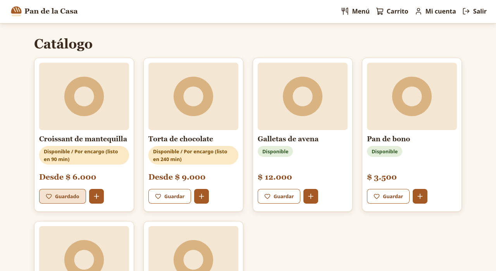
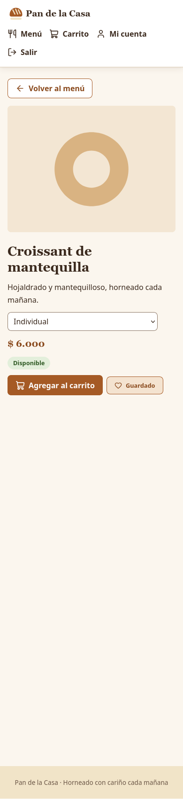
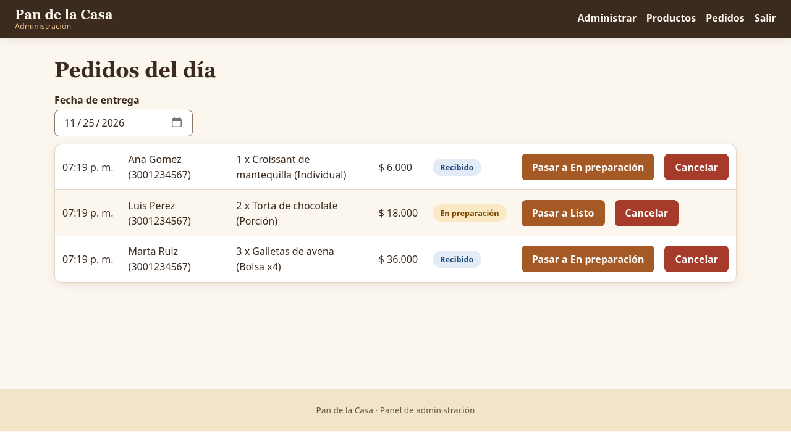
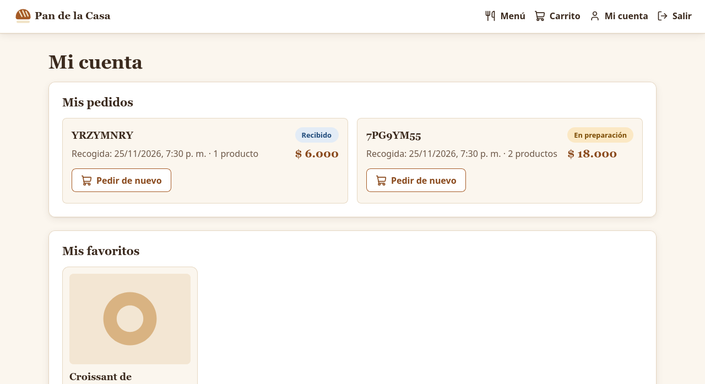
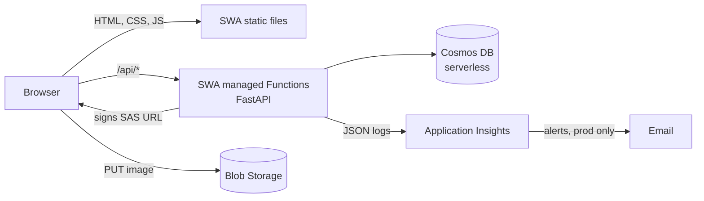
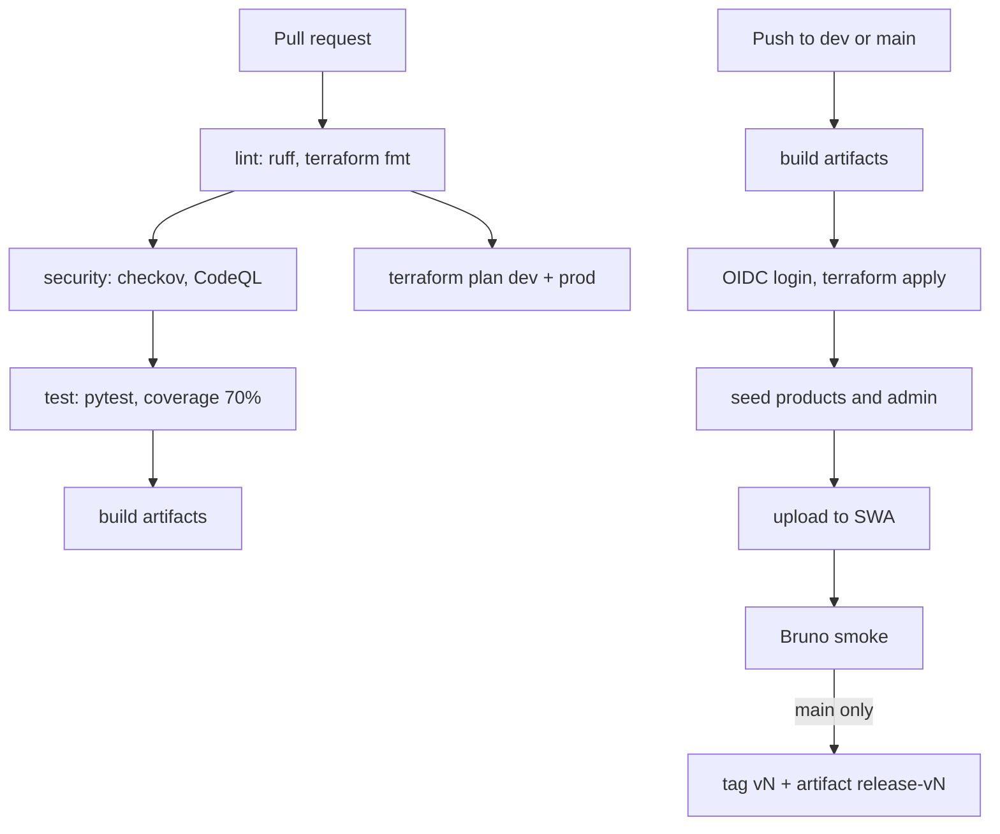

# migas-en-la-nube

Pan de la Casa: a bakery ordering platform on Azure. Customers browse the catalog, order for pickup (guest or registered), and keep favorites. An admin manages products, images and order status.

| Catalog | Product (mobile) |
| --- | --- |
|  |  |

| Admin products | Admin orders |
| --- | --- |
|  |  |



## Architecture

Static Web Apps (SWA) serves the front end and runs the FastAPI API as managed Functions. Data is in Cosmos DB, images in Blob Storage. Everything is created by Terraform and deployed only by GitHub Actions.



More detail in [docs/diagramas/architecture.md](docs/diagramas/architecture.md). Decisions are in [docs/adr](docs/adr/README.md).

## Repository layout

| Folder | Purpose |
| --- | --- |
| `api/` | FastAPI app (`app/`), Functions entry (`http_app/`), seed scripts (`scripts/`) |
| `web/` | Static front end: HTML, CSS, ES modules, `staticwebapp.config.json` (CSP, fallback) |
| `infra/` | Terraform: `bootstrap/` (one-time, local), `modules/`, `envs/dev`, `envs/prod` |
| `tests/` | Unit and integration tests |
| `smoke/` | Bruno smoke collection run after each deploy |
| `.github/` | Workflows (`ci`, `deploy`, `rollback`, `destroy`) and composite actions |
| `docs/` | HLD, deployment design, ADRs, Mermaid diagrams, screenshots |

## Local run

```bash
python3.11 -m venv .venv311 && source .venv311/bin/activate
pip install -r requirements-dev.txt
cd api && uvicorn app.main:app --reload
curl http://localhost:8000/api/health
```

Locally the API uses in-memory repositories: no Azure account needed, data is lost on restart. Run the tests from the repo root with `pytest --cov`.

Settings come from environment variables:

| Variable | Purpose | Default |
| --- | --- | --- |
| `PDC_ENVIRONMENT` | `local`, `dev` or `prod`. Memory fallbacks work only for `local`. | `local` |
| `PDC_VERSION` | Version reported by `/api/health` | `0.1.0` |
| `PDC_JWT_KEY` | HS256 key. Needed to log in. Set any string locally. | empty |
| `PDC_COSMOS_CONNECTION_STRING` | Cosmos DB. Required outside `local`. | empty |
| `PDC_STORAGE_CONNECTION_STRING` | Blob account that signs SAS upload URLs. Required outside `local`. | empty |
| `PDC_IMAGES_CONTAINER_URL` | Public URL of the images container. Checked once the storage connection string is set (outside `local`): the placeholder is rejected. | local placeholder |
| `PDC_LOGIN_FAILURE_DELAY_SECONDS` | Pause after a failed login | `0.5` |

The front end is plain static files. To use it locally, serve `web/` and `/api` from the same origin (the CSP allows only `self`).

## API overview

All routes are under `/api`. Errors are JSON `{"detail": "..."}`.

| Access | Routes |
| --- | --- |
| Public | `GET /health`, `GET /products`, `GET /products/{id}`, `POST /auth/register`, `POST /auth/login` |
| Public or customer | `POST /orders` (guest or logged in; a logged-in order is linked to the user; an admin gets 403) |
| Customer | `GET /me/orders`, `GET /me/favorites`, `PUT` and `DELETE /me/favorites/{productId}`, `GET /me/top-products` |
| Admin | `POST /admin/products`, `PUT` and `DELETE /admin/products/{id}`, `POST /admin/products/{id}/image-upload-url`, `GET /admin/orders` (upcoming by default, `?scope=history` for past orders, or `?date=` for one day), `PATCH /admin/orders/{id}/status` |

Authenticated calls send `X-Pdc-Token: Bearer <jwt>`. The standard `Authorization` header is not used because SWA managed Functions overwrite it (see [ADR 0003](docs/adr/0003-own-jwt-authentication.md)).

Admin `PUT /admin/products/{id}` requires the `etag` from the product response; a stale `etag` returns 409.

Status codes: 401 for any login or token problem, 403 for the wrong role, 404 not found, 409 conflict (duplicate email, stock conflict), 422 rule or validation error.

## Environments

| | dev | prod |
| --- | --- | --- |
| Branch | `dev` | `main` |
| GitHub environment | `dev` | `prod` (required reviewers) |
| SWA tier | Free | Standard |
| Alerts and availability test | no | yes |
| URL | https://wonderful-field-023b47e10.4.azurestaticapps.net | the `base-url` input of the smoke step in the `deploy` run of `main` |
| Smoke | full Bruno collection (creates test users and orders) | read-only folder |

Each environment has its own resource group, Terraform state, Cosmos account, storage account and deploy identity.

## CI/CD pipeline



- `ci.yml` (pull requests): `lint`, `security` (Checkov, CodeQL), `test` (coverage floor 70%), `build`, and a read-only `terraform` plan for both environments.
- `deploy.yml` (push to `dev` or `main`): build, Terraform apply, seed products and admin (idempotent), upload `web/` and `api/` to SWA, wait for `/api/health`, run the Bruno collection in `smoke/` (everything on dev, read-only on prod).
- `release` job (only after a green prod deploy): stores the artifacts as `release-v<run number>` for 90 days and creates the tag `v<run number>`.

Diagram source: [docs/diagramas/pipeline.md](docs/diagramas/pipeline.md).

## Operations

### Alerts (prod only)

Terraform creates an availability test (`GET /api/health`, every 15 minutes from two locations), an alert when both locations fail within 15 minutes, and an alert for more than 5 server errors (5xx) in 15 minutes. Both send email through an action group. The address is the GitHub variable `ALERT_EMAIL` of the `prod` environment.

### Logs

Every request writes one JSON line to Application Insights: `method`, `path`, `status`, `duration_ms`, `correlation_id`. A valid incoming `x-correlation-id` header (up to 64 characters of `A-Z a-z 0-9 . _ -`) is reused. Otherwise the API makes one. The id is in logs only, not in responses. Example Log Analytics query:

```kusto
traces | where message has "<correlation-id>" | order by timestamp desc
```

### Rollback

`rollback.yml` redeploys the stored artifact of an earlier prod release. It does not run Terraform and does not change data.

1. Pick a tag from `git tag` (for example `v12`).
2. Actions, `rollback`, Run workflow from `main`, input `tag = v12`.
3. Approve the `prod` environment deployment.
4. The job checks the tag format, finds the successful deploy run on `main` with that run number, downloads `release-v12`, uploads it to the prod SWA and runs the read-only smoke.

To roll forward, run it again with a newer tag. Diagram: [docs/diagramas/rollback.md](docs/diagramas/rollback.md).

### Destroy

`destroy.yml` runs `terraform destroy` for one environment, data included. It needs two inputs: `environment` and `confirm` (type the same name). `dev` can run from `dev` or `main`; `prod` only from `main` and needs approval. A wrong confirmation is rejected before any approval is requested.

Final cleanup order (only after the project defense):

1. `destroy.yml` with `environment = prod`, `confirm = prod`, approve.
2. `destroy.yml` with `environment = dev`, `confirm = dev`.
3. Destroy the bootstrap stack from a laptop, following [infra/bootstrap/README.md](infra/bootstrap/README.md).

The resource groups remain until step 3. GitHub environments and the repository stay.

## Security notes

- Azure access uses GitHub OIDC with three identities (`ci-plan` read-only, `deploy-dev`, `deploy-prod`). No Azure secret is stored in GitHub.
- Tokens and connection strings read from Terraform outputs are masked in logs (`::add-mask::`).
- Strict CSP in `web/staticwebapp.config.json`: scripts and styles only from `self`, images and uploads allowed to `*.blob.core.windows.net`. The UI renders with `textContent`, never `innerHTML`.
- Image uploads use a SAS URL for one blob, create and write only, valid 5 minutes, https only. The browser upload needs the storage CORS rule that Terraform sets for the SWA host. The 2 MB limit is checked in the browser only.
- Passwords use scrypt. Tokens are HS256 JWTs valid for 1 hour. See [ADR 0003](docs/adr/0003-own-jwt-authentication.md).
- Login failures return one generic 401 that does not reveal which accounts exist. Registration answers 409 "Email already registered", so an email can be probed there (see Known limits).
- The `ci-plan` identity has Storage Blob Data Reader on the Terraform state account, and the state contains secrets. Its federated subject is `pull_request`, so any same-repository PR can read the state. Only collaborators can open those PRs, and fork PRs get no OIDC token.
- Destroy needs a typed confirmation, and prod destroy needs approval.

## Costs

- Dev uses the SWA Free tier. Prod uses Standard, which has a monthly price. See the Azure pricing calculator.
- Cosmos DB is serverless, Blob Storage and Application Insights are pay per use at low volume. A subscription budget (50, 80 and 100 percent thresholds) is created by the bootstrap stack.
- The prod availability test (one test, 15-minute interval, two locations) is the main recurring monitoring cost. Price it with the Azure pricing calculator before leaving prod running, and reduce it to one location if needed.
- Destroying an environment removes its billable resources.

## Known limits

- Rollback keeps `PDC_VERSION` at the newest deploy SHA, so `/api/health` `version` does not match the rolled-back tag.
- Release artifacts expire after 90 days. A tag older than that cannot be rolled back to. Only the last 200 deploy runs are searched.
- Two customers can still take the last unit at the same moment: the second order is accepted as made to order.
- Replacing a product image leaves the old blob. A product deleted by an admin is recreated by the next deploy seed.
- The memory fallback for Cosmos and Blob exists only for `PDC_ENVIRONMENT=local`.
- Account enumeration: registration reveals whether an email is already taken (409). This is an accepted limit.
- The JWT lives in `localStorage` and a role change applies only after the token expires.

## Documentation

- [High-level design (HLD, Spanish)](docs/hld.md)
- [Deployment design (Spanish)](docs/despliegue.md)
- [Architecture decision records](docs/adr/README.md)
- Diagrams (Spanish, Mermaid): [context](docs/diagramas/contexto.md), [architecture](docs/diagramas/architecture.md), [network and security](docs/diagramas/red-seguridad.md), [pipeline](docs/diagramas/pipeline.md), [rollback](docs/diagramas/rollback.md). Older PNG exports (English): [architecture](docs/diagramas/architecture.png), [pipeline](docs/diagramas/pipeline.png), [rollback](docs/diagramas/rollback.png)
- [Bootstrap and final cleanup](infra/bootstrap/README.md)
