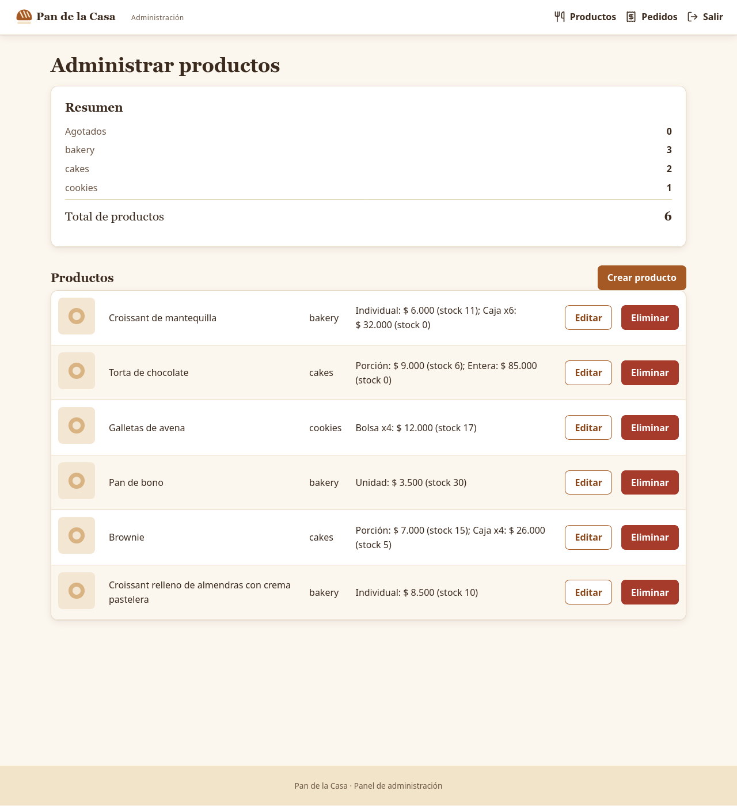
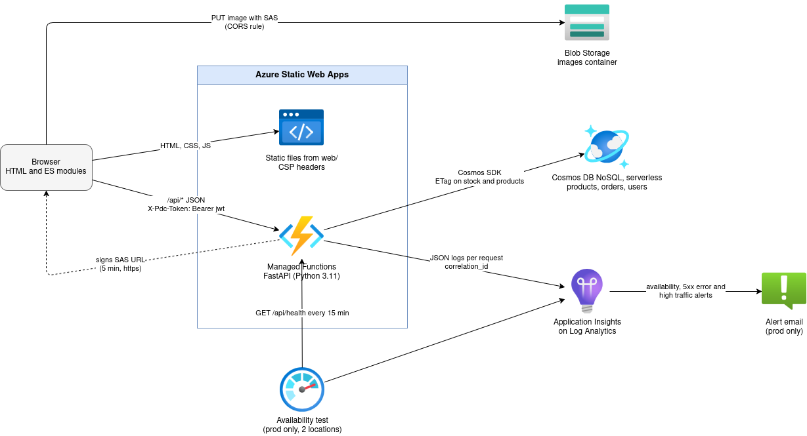
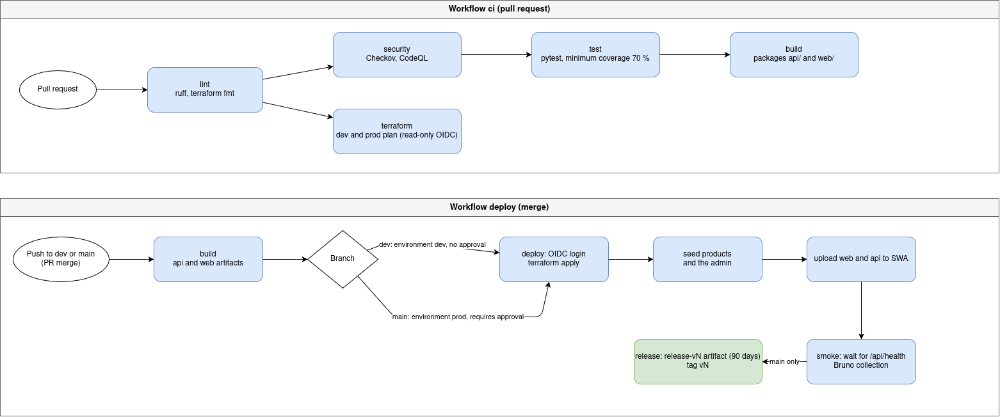

# Migas en la Nube

A bakery ordering platform on Azure. Customers browse the catalog and order for pickup. An admin manages products and orders.

Built for the "Pan de la Casa" bakery case (Escuela Colombiana de Ingeniería, Cloud Architecture project); the platform is called Migas en la Nube.

## Live demo

- Production: https://salmon-stone-0be061010.6.azurestaticapps.net (health check: `/api/health`, admin panel: `/admin/`)
- Development: https://wonderful-field-023b47e10.4.azurestaticapps.net

## Screenshots

| Catalog | Product (mobile) |
| --- | --- |
|  |  |

| Admin products | Admin orders |
| --- | --- |
|  |  |


## What it does

- Browse the catalog with photos, prices and variants.
- Order for pickup as a guest or with an account, and choose a pickup time.
- Registered customers get favorites, order history and their top products.
- Admins create and edit products, upload images and set stock ("Hornear").
- Admins see upcoming and past orders and change their status.

## How it works

Static Web Apps (SWA) serves the front end and runs the FastAPI API as managed Functions. Data is in Cosmos DB and images are in Blob Storage. Terraform creates everything. GitHub Actions is the only way to deploy.



Source: [docs/diagrams/architecture.drawio](docs/diagrams/architecture.drawio). Decisions: [docs/adr](docs/adr/README.md).

Tech: Azure Static Web Apps + managed Functions (Python, FastAPI), Cosmos DB serverless, Blob Storage, Application Insights, Terraform, GitHub Actions with OIDC (no Azure secrets in GitHub).

**Pipeline.** A pull request runs lint, security scans (Checkov, CodeQL), tests (70% coverage minimum) and a Terraform plan. A push to `dev` or `main` runs the tests first and stops if they fail, then builds, applies Terraform, seeds data, deploys, runs the Bruno smoke tests in `smoke/`, and (on `main` only) publishes a release tag `v<run number>`. `rollback.yml` redeploys an older release. `load.yml` runs a k6 load test. Details: [docs/deployment.md](docs/deployment.md).



Source: [docs/diagrams/pipeline.drawio](docs/diagrams/pipeline.drawio).

## Run it locally

```bash
python3.11 -m venv .venv311 && source .venv311/bin/activate
pip install -r requirements-dev.txt
cd api && uvicorn app.main:app --reload
curl http://localhost:8000/api/health
```

Locally the API uses in-memory data, so no Azure account is needed. Data is lost on restart. Run the tests from the repo root with `pytest --cov`.

The front end is plain static files. To use it locally, serve `web/` and `/api` from the same origin (the CSP allows only `self`).

Settings come from environment variables:

| Variable | Purpose | Default |
| --- | --- | --- |
| `PDC_ENVIRONMENT` | `local`, `dev` or `prod`. Memory fallbacks work only for `local`. | `local` |
| `PDC_VERSION` | Version reported by `/api/health` | `0.1.0` |
| `PDC_JWT_KEY` | HS256 key. Needed to log in. Set any string locally. | empty |
| `PDC_COSMOS_CONNECTION_STRING` | Cosmos DB. Required outside `local`. | empty |
| `PDC_STORAGE_CONNECTION_STRING` | Blob account that signs SAS upload URLs. Required outside `local`. | empty |
| `PDC_IMAGES_CONTAINER_URL` | Public URL of the images container. Checked once the storage connection string is set (outside `local`): the placeholder is rejected. | local placeholder |
| `PDC_LOGIN_FAILURE_DELAY_SECONDS` | Pause after a failed login | `0.5` |

## Docs

- [High-level design (HLD, Spanish)](docs/hld.md)
- [Deployment design (Spanish)](docs/deployment.md)
- [Architecture decision records](docs/adr/README.md)
- [Diagrams (draw.io sources)](docs/diagrams/)
- [Load test](load/README.md)
- [Cost estimate (Excel)](docs/costs/azure.xlsx)
- [Bootstrap and final cleanup](infra/bootstrap/README.md)

## Reference

<details>
<summary>API</summary>

All routes are under `/api`. Errors are JSON `{"detail": "..."}`.

| Access | Routes |
| --- | --- |
| Public | `GET /health`, `GET /products`, `GET /products/{id}`, `POST /auth/register`, `POST /auth/login` |
| Public or customer | `POST /orders` (a logged-in order is linked to the user; an admin gets 403) |
| Customer | `GET /me/orders`, `GET /me/favorites`, `PUT` and `DELETE /me/favorites/{productId}`, `GET /me/top-products` |
| Admin | `POST /admin/products`, `PUT` and `DELETE /admin/products/{id}`, `POST /admin/products/{id}/image-upload-url`, `GET /admin/orders` (upcoming by default; `?scope=history` or `?date=`), `PATCH /admin/orders/{id}/status` |

Authenticated calls send `X-Pdc-Token: Bearer <jwt>`. The standard `Authorization` header is not used because SWA managed Functions overwrite it ([ADR 0003](docs/adr/0003-own-jwt-authentication.md)). Admin `PUT /admin/products/{id}` needs the `etag` from the product response; a stale one returns 409.

Status codes: 401 login or token problem, 403 wrong role, 404 not found, 409 conflict (duplicate email, stock, etag), 422 rule or validation error.

</details>

<details>
<summary>Environments</summary>

| | dev | prod |
| --- | --- | --- |
| Branch | `dev` | `main` |
| GitHub environment | `dev` | `prod` (required reviewers) |
| SWA tier | Free | Standard |
| Alerts and availability test | no | yes |
| Smoke | full Bruno collection (creates test users and orders) | read-only folder |

Each environment has its own resource group, Terraform state, Cosmos account, storage account and deploy identity. URLs are in Live demo.

</details>

<details>
<summary>Operations</summary>

- **Alerts (prod only).** An availability test (`GET /api/health`, every 15 minutes from two locations) alerts when both locations fail. Other alerts: more than 5 server errors in 15 minutes, and more than 1,500 API requests in 5 minutes (informational; the `stress` load scenario fires it). All send email to the GitHub variable `ALERT_EMAIL` of the `prod` environment. Details: HLD section 6.
- **Logs.** Each request writes one JSON line to Application Insights (`method`, `path`, `status`, `duration_ms`, `correlation_id`). A valid `x-correlation-id` header is reused; otherwise the API makes one. Query: `traces | where message has "<correlation-id>" | order by timestamp desc`.
- **Rollback.** `rollback.yml` redeploys the stored artifact of an earlier prod release (for example `v12`). It runs from `main`, needs `prod` approval, and does not run Terraform or change data. Steps: [docs/deployment.md](docs/deployment.md#rollback).
- **Load test.** `load.yml` runs k6 on manual dispatch. `realistic`, `peak3x` and `stress` only read, so they are allowed on prod; run `stress` off-hours and once, because it can cause real errors and fire alerts. `orders` creates orders and is refused on prod. See [load/README.md](load/README.md).
- **Destroy.** `destroy.yml` runs `terraform destroy` for one environment, data included. It needs `environment` and a matching `confirm`. `dev` runs from `dev` or `main`; `prod` only from `main` with approval. Final cleanup order: [infra/bootstrap/README.md](infra/bootstrap/README.md#destroy).

</details>

<details>
<summary>Security notes</summary>

- Azure access uses GitHub OIDC with three identities (`ci-plan` read-only, `deploy-dev`, `deploy-prod`). Tokens and connection strings from Terraform outputs are masked in logs.
- Strict CSP in `web/staticwebapp.config.json`. The UI renders with `textContent`, never `innerHTML`.
- Image uploads use a SAS URL for one blob: create and write only, 5 minutes, https only. The 2 MB limit is checked in the browser only.
- Passwords use scrypt. Tokens are HS256 JWTs valid for 1 hour.
- Login failures return one generic 401. Registration answers 409 "Email already registered", so an email can be probed (accepted limit).
- The `ci-plan` identity can read the Terraform state, which contains secrets. Its subject is `pull_request`, so any same-repository PR can read it. Only collaborators can open those PRs, and fork PRs get no OIDC token.

</details>

<details>
<summary>Costs</summary>

- Prod costs about USD 15 per month (limit: USD 150). Dev uses the free SWA tier.
- Cosmos DB is serverless; Blob Storage and Application Insights are pay per use. The bootstrap stack creates a USD 20 monthly subscription budget with alerts at 50, 80 and 100 percent (USD 10, 16 and 20).
- The prod availability test is the main recurring monitoring cost (about USD 3.3 per month). Use one location to reduce it.
- Sources: [docs/costs/azure.xlsx](docs/costs/azure.xlsx) and the [shared estimate](https://pruebacorreoescuelaingeduco-my.sharepoint.com/:f:/g/personal/andres_chavarro-p_mail_escuelaing_edu_co/IgCR8FX61djzRbgw5dP906NYAepx9R_9yznGnveKeQa_p98?e=jm11ry).

</details>

<details>
<summary>Known limits</summary>

- After a rollback, `/api/health` `version` still shows the newest deploy SHA.
- Release artifacts expire after 90 days. Rollback searches only the last 200 deploy runs.
- Two customers can take the last unit at the same moment; the second order is accepted as made to order.
- Replacing a product image leaves the old blob. A product deleted by an admin is recreated by the next deploy seed.
- The JWT lives in `localStorage`, and a role change applies only after the token expires.
- No JavaScript unit tests: the web layer is covered by static rules (`tests/unit/test_web_static_rules.py`) and the dev smoke collection.

</details>

<details>
<summary>Repository layout</summary>

| Folder | Purpose |
| --- | --- |
| `api/` | FastAPI app (`app/`), Functions entry (`http_app/`), seed scripts (`scripts/`) |
| `web/` | Static front end and `staticwebapp.config.json` |
| `infra/` | Terraform: `bootstrap/` (one-time, local), `modules/`, `envs/dev`, `envs/prod` |
| `tests/` | Unit and integration tests |
| `smoke/` | Bruno smoke collection run after each deploy |
| `load/` | k6 load test |
| `.github/` | Workflows (`ci`, `deploy`, `rollback`, `destroy`, `load`) and composite actions |
| `docs/` | HLD, deployment design, ADRs, diagrams, screenshots |

</details>
