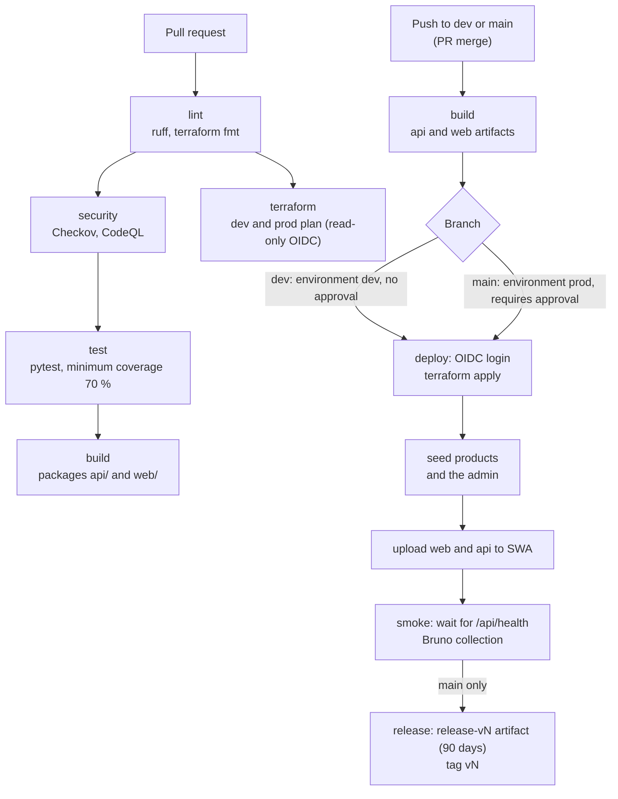
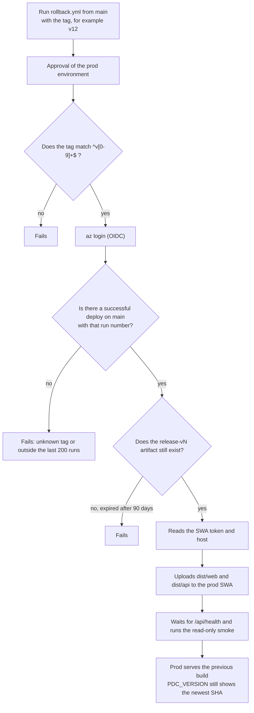

# Diseño de despliegue

Todo llega a Azure por GitHub Actions: nada se despliega a mano. Este documento amplía la sección 7 del [HLD](hld.md) y se mantiene consistente con ella y con el [README](../README.md).

## Etapas del pipeline

El workflow `ci` corre en el pull request y el workflow `deploy` corre al hacer merge. El despliegue no repite lint ni pruebas.

| Etapa | Workflow y job | Qué hace | Qué bloquea si falla |
| --- | --- | --- | --- |
| Lint | `ci`, `lint` | `ruff check`, `ruff format --check` y `terraform fmt -check` | Seguridad, pruebas, build y plan de Terraform |
| Seguridad | `ci`, `security` | Checkov sobre `infra` y CodeQL sobre Python | Pruebas y build |
| Pruebas | `ci`, `test` | `pytest` con cobertura mínima de 70 %: unitarias e integración por HTTP | Build |
| Build | `ci`, `build` | Instala las dependencias del API y empaqueta `api/` y `web/` como artefactos | El check del pull request |
| Plan de Terraform | `ci`, `terraform` | `init`, `validate` y `plan` de dev y prod con la identidad de solo lectura, sin refrescar ni bloquear el estado | El check del pull request |
| Build del despliegue | `deploy`, `build` | El mismo empaquetado, sobre el commit ya integrado | El despliegue |
| Despliegue | `deploy`, `deploy` | Login OIDC, `terraform apply`, carga de seeds (productos y administrador) y subida a Static Web Apps | El smoke test y el release |
| Smoke test | `deploy`, acción `smoke` | Espera `/api/health` (hasta 12 reintentos, unos 2 minutos) y corre la colección Bruno | El release |
| Release | `deploy`, `release` (solo `main`) | Guarda el artefacto `release-vN` 90 días y crea la etiqueta `vN` | Nada: es el último paso |

`N` es el número de ejecución del workflow `deploy`. Los seeds son idempotentes: el de productos solo crea los productos que faltan, no pisa las ediciones del administrador, y un producto del seed que se borre reaparece en el siguiente despliegue, y el del administrador deja el rol y la contraseña según los valores del environment.

## Ambientes y promoción

| Ambiente | Rama | Environment de GitHub | Static Web Apps | Aprobación | Alertas y prueba de disponibilidad |
| --- | --- | --- | --- | --- | --- |
| dev | `dev` | `dev` | Free | No | No |
| prod | `main` | `prod` | Standard | Revisor requerido | Sí |

Cada ambiente tiene su propio grupo de recursos (`rg-pdc-dev` y `rg-pdc-prod`), estado de Terraform (`tfstate-dev` y `tfstate-prod`), cuenta de Cosmos DB, cuenta de Storage e identidad de despliegue.

Un cambio se promueve así:

1. Se abre un pull request hacia `dev`. El workflow `ci` corre y debe quedar en verde.
2. Al hacer merge a `dev`, `deploy` despliega y prueba el ambiente dev sin aprobación.
3. Con dev verificado, se abre un pull request de `dev` hacia `main`. `ci` corre otra vez.
4. Al hacer merge a `main`, `deploy` queda detenido en el environment `prod` hasta que el revisor aprueba. Luego despliega prod, corre el smoke de solo lectura y publica el release `vN`.

En GitHub existe un ruleset `general` sobre `dev` y `main` que impide borrar la rama y hacer push forzado, exige pull request y exige checks. El ruleset existe, pero su estado de aplicación está pendiente de verificar por el equipo. Los checks requeridos deben ser los nombres de los jobs de `ci.yml`: `lint`, `security`, `test`, `build` y `terraform`. Como `deploy.yml` no vuelve a correr los tests, esta compuerta del pull request es lo que impide un despliegue roto.

## Ramas y disparadores

| Evento | Qué corre |
| --- | --- |
| Pull request (`ci.yml`) | `lint`, luego `security` y `terraform` (plan de dev y prod), luego `test` y `build`. Sin permisos de escritura sobre Azure |
| Push a `dev` (`deploy.yml`) | `build` y `deploy` en el environment `dev`: Terraform, seeds, subida y smoke completo. No hay `release` |
| Push a `main` (`deploy.yml`) | `build`, `deploy` en el environment `prod` tras la aprobación, y `release` |
| Ejecución manual de `rollback.yml` | Solo desde `main`, con el input `tag`. Aprobación de `prod`, vuelve a publicar el artefacto `release-<tag>` y corre el smoke de solo lectura |
| Ejecución manual de `destroy.yml` | Inputs `environment` y `confirm`. Destruye con `terraform destroy` el ambiente elegido |

`deploy.yml` usa un grupo de concurrencia por rama (`deploy-dev` o `deploy-main`) sin cancelar ejecuciones en curso. `rollback.yml` y el destroy de prod comparten el grupo `deploy-main`, así que esperan a un despliegue que esté corriendo.

## Secretos e identidades

GitHub Actions entra a Azure con OIDC y `azure/login`, sin contraseñas guardadas. Cada identidad solo acepta el `subject` que le corresponde, y los permisos por identidad están en la sección 4 del HLD y en el diagrama [red-seguridad](diagramas/red-seguridad.md).

| Identidad | `subject` de GitHub | Workflow |
| --- | --- | --- |
| `id-pdc-ci-plan` | `pull_request` | `ci`, job `terraform` |
| `id-pdc-deploy-dev` | `environment:dev` | `deploy` y `destroy` de dev |
| `id-pdc-deploy-prod` | `environment:prod` | `deploy`, `rollback` y `destroy` de prod |

Variables y secretos de GitHub:

| Nombre | Tipo | Dónde | Para qué |
| --- | --- | --- | --- |
| `AZURE_TENANT_ID`, `AZURE_SUBSCRIPTION_ID` | Variable | Repositorio | Datos de la suscripción para el login |
| `AZURE_CLIENT_ID_PLAN` | Variable | Repositorio | Cliente de `id-pdc-ci-plan` |
| `TFSTATE_RESOURCE_GROUP`, `TFSTATE_ACCOUNT` | Variable | Repositorio | Dónde está el estado de Terraform |
| `AZURE_CLIENT_ID` | Variable | Environments `dev` y `prod` | Cliente de la identidad de despliegue de cada ambiente |
| `ADMIN_EMAIL` | Variable | Environments `dev` y `prod` | Correo del administrador que crea el seed |
| `ALERT_EMAIL` | Variable | Environment `prod` | Destino de las alertas |
| `ADMIN_INITIAL_PASSWORD` | Secreto | Environments `dev` y `prod` | Contraseña del administrador que aplica el seed |

Los IDs son variables y no secretos porque no sirven sin el token OIDC del repositorio. Solo la contraseña del administrador es un secreto de GitHub. Los demás secretos (llaves de Cosmos DB y Storage, llave de los JWT) los genera Terraform y viven en la configuración de la app en Azure. Los tokens y cadenas de conexión que el pipeline lee de las salidas de Terraform se enmascaran en los logs con `::add-mask::`. Cada workflow declara permisos mínimos: `id-token: write` solo en los jobs que entran a Azure y `contents: write` solo en el job `release`.

## Rollback

| Qué falló | Cómo se vuelve atrás |
| --- | --- |
| La aplicación | `rollback.yml` con el tag de una versión anterior. No corre Terraform ni cambia datos |
| La infraestructura | Revertir el commit en git y dejar que el pipeline aplique Terraform de nuevo |
| Los datos | Restauración de Cosmos DB a un punto en el tiempo (HLD, sección 5). El simulacro de restauración está pendiente |

Pasos para el rollback de la aplicación:

1. Elegir un tag con `git tag`, por ejemplo `v12`.
2. En Actions, `rollback`, Run workflow desde `main` con `tag = v12`.
3. Aprobar el despliegue del environment `prod`.
4. El job valida el formato del tag, busca el deploy exitoso en `main` con ese número, descarga `release-v12`, lo sube a la Static Web App de prod y corre el smoke de solo lectura.

Para volver hacia adelante se ejecuta de nuevo con un tag más nuevo. El rollback no corre Terraform a propósito, para no deshacer cambios de infraestructura que sí estaban bien. Límites: los artefactos vencen a los 90 días, solo se buscan las últimas 200 ejecuciones de `deploy` y `/api/health` sigue mostrando la versión más nueva.

## Destroy y limpieza final

`destroy.yml` ejecuta `terraform destroy` sobre un ambiente, con los datos incluidos. Pide dos inputs, `environment` y `confirm`, que deben ser iguales. `dev` se puede destruir desde `dev` o `main`, y `prod` solo desde `main` y con aprobación. Si la confirmación es incorrecta, el job `guard` falla antes de pedir ninguna aprobación. Destruye solo lo que Terraform administra en el ambiente: los grupos de recursos son del bootstrap y siguen existiendo.

El orden de la limpieza final (solo después de la defensa del proyecto) y por qué importa están en [infra/bootstrap/README.md](../infra/bootstrap/README.md#destroy).
