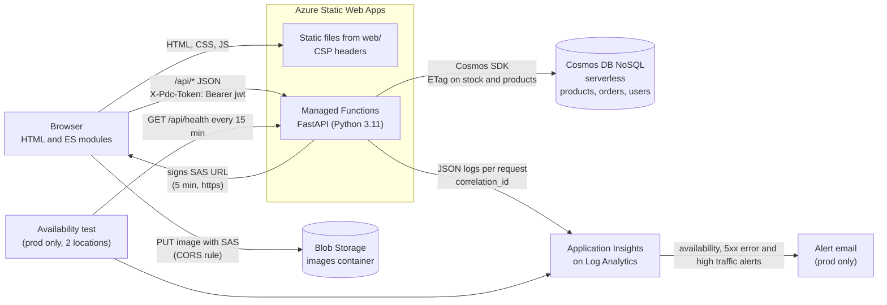
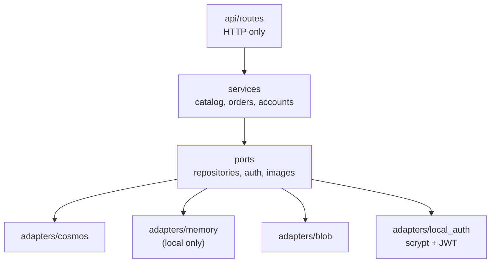

# Architecture

Mermaid source: GitHub renders it in the preview. Technical names are kept as in the code. The `.drawio` files in this folder are the editable sources with official Azure icons.

## Layers inside the API

