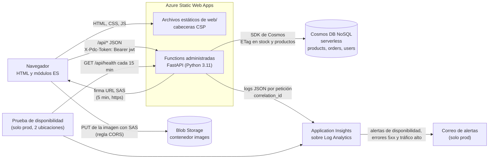
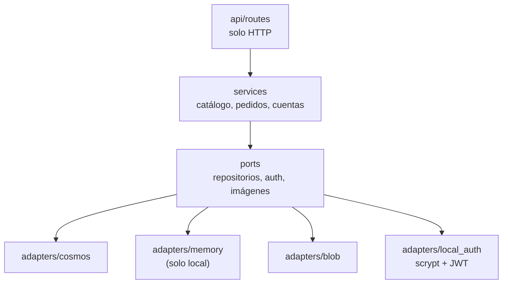

# Arquitectura

Fuente Mermaid: GitHub la muestra en la vista previa. Los nombres técnicos se dejan como en el código. Los archivos `.drawio` de esta carpeta son las fuentes editables con iconos oficiales de Azure.

## Capas dentro del API

