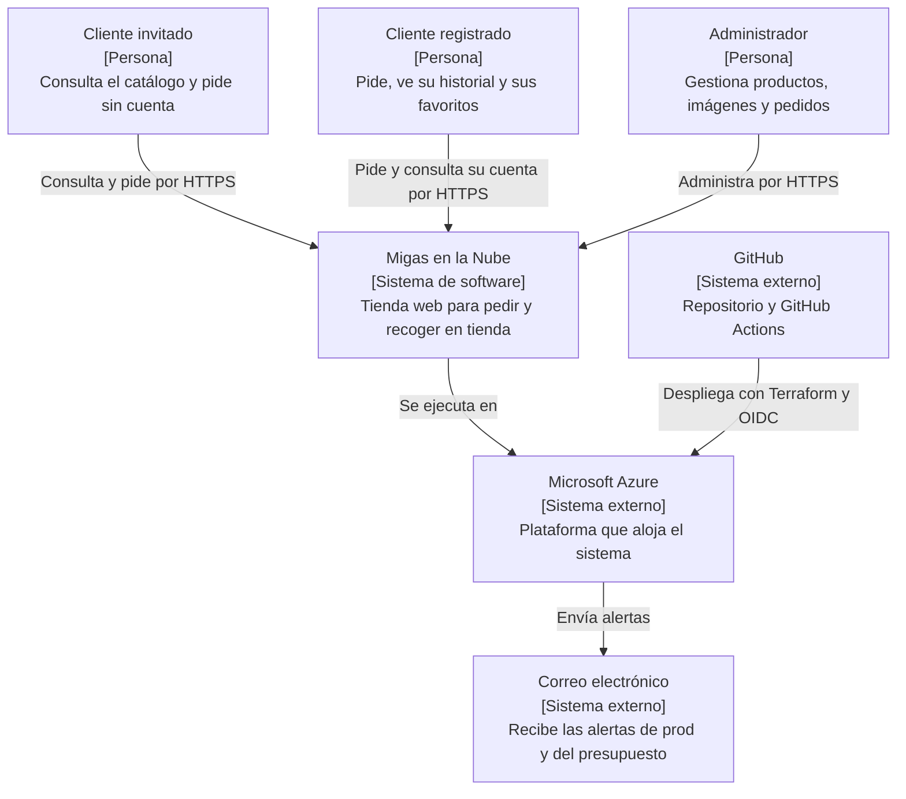

# Contexto (C4 nivel 1)

Quién usa Migas en la Nube y con qué sistemas externos se relaciona. Fuente Mermaid: GitHub la muestra en la vista previa.

El administrador usa el mismo sitio web que los clientes, con un rol distinto. Las alertas por correo solo existen en producción, y el aviso de presupuesto lo envía la suscripción de Azure.
