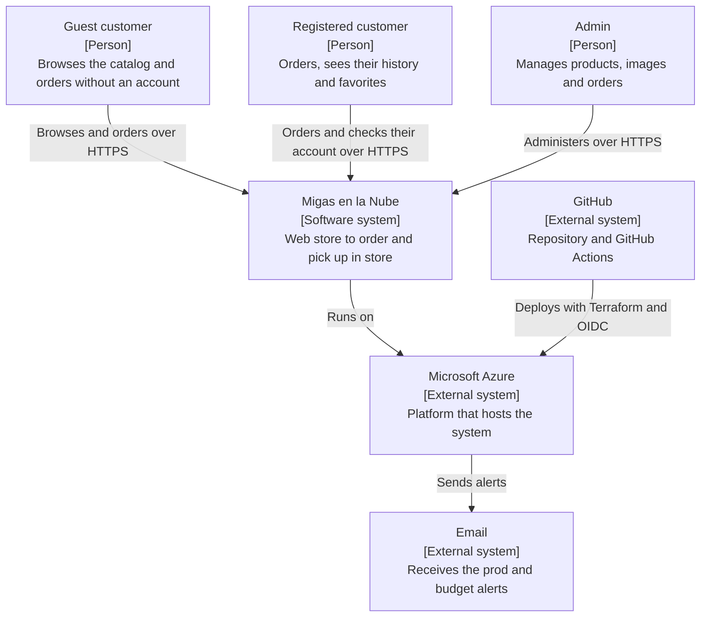

# Context (C4 level 1)

Who uses Migas en la Nube and which external systems it relates to. Mermaid source: GitHub renders it in the preview.

The admin uses the same website as customers, with a different role. Email alerts exist only in production, and the budget notice is sent by the Azure subscription.
