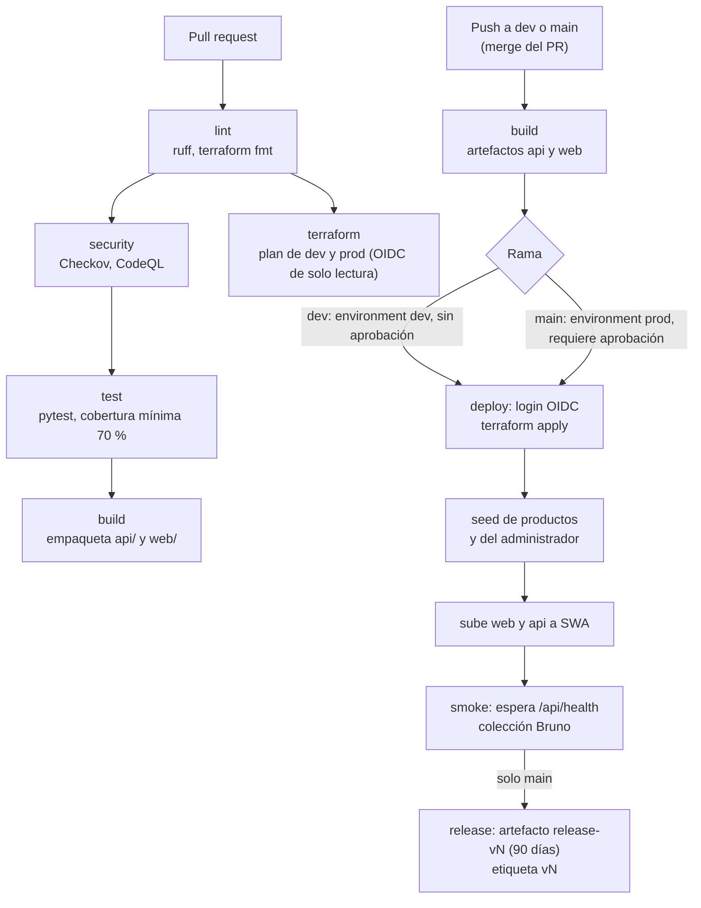

# Pipeline de CI/CD

Fuente Mermaid: GitHub la muestra en la vista previa.

`N` es el número de ejecución de `deploy.yml`. El workflow `ci` corre en el pull request y `deploy` corre al hacer merge: el despliegue no repite lint ni pruebas.
