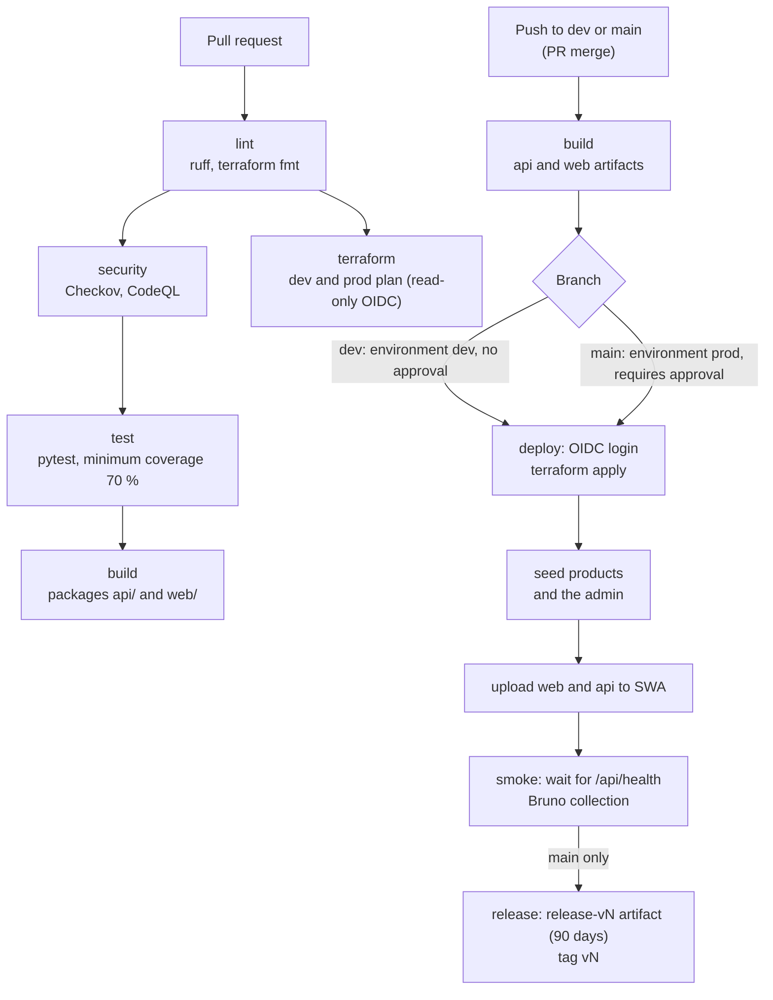

# CI/CD pipeline

Mermaid source: GitHub renders it in the preview.

`N` is the run number of `deploy.yml`. The `ci` workflow runs on the pull request and `deploy` runs on merge: the deployment does not repeat lint or tests.
