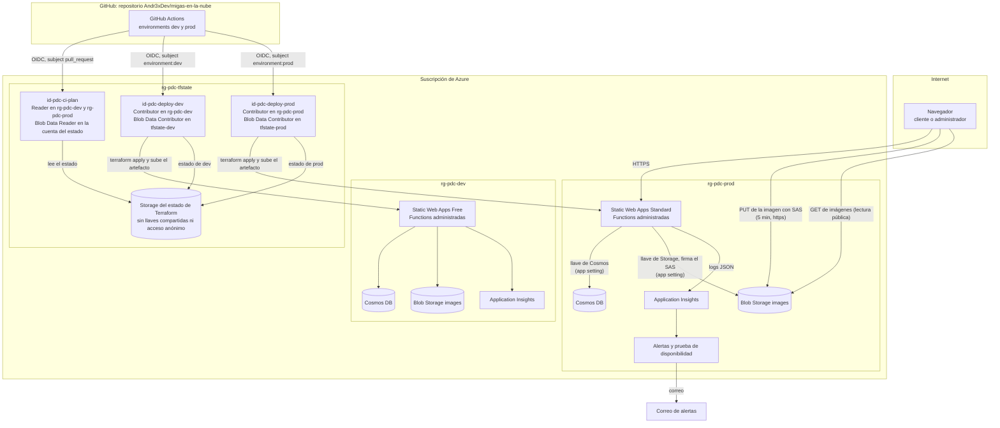

# Red y seguridad

Zonas, flujos e identidades. No hay red virtual: los servicios se exponen por HTTPS y se protegen con llaves en la configuración de la app y con identidades OIDC en el pipeline.

Las identidades y sus roles están en `infra/bootstrap/identities.tf` y `infra/bootstrap/roles.tf`. GitHub entrega un token OIDC y Microsoft Entra ID lo cambia por acceso a la identidad cuyo subject coincide. Dev no tiene alertas ni prueba de disponibilidad.
