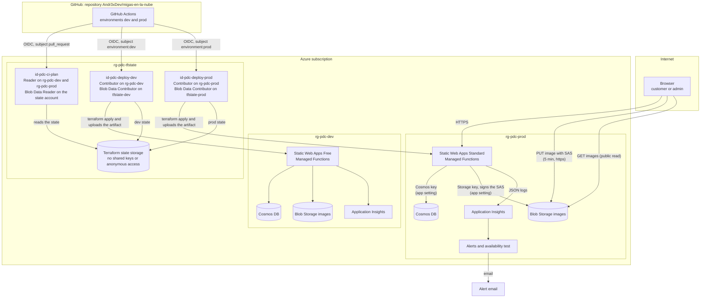

# Network and security

Zones, flows and identities. There is no virtual network: services are exposed over HTTPS and protected with keys in the app configuration and with OIDC identities in the pipeline.

The identities and their roles are in `infra/bootstrap/identities.tf` and `infra/bootstrap/roles.tf`. GitHub issues an OIDC token and Microsoft Entra ID exchanges it for access to the identity whose subject matches. Dev has no alerts or availability test.
