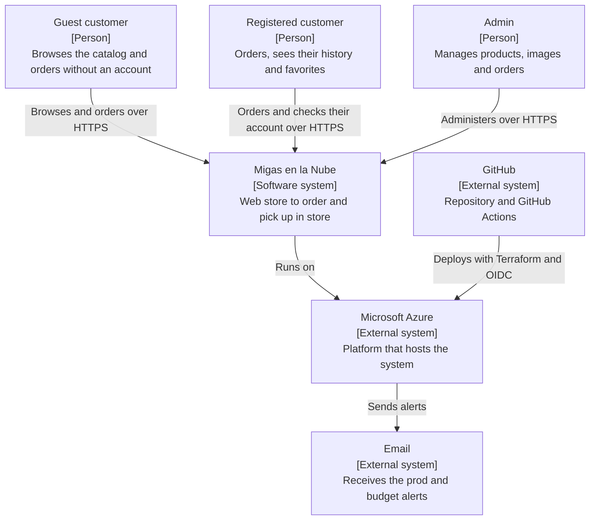
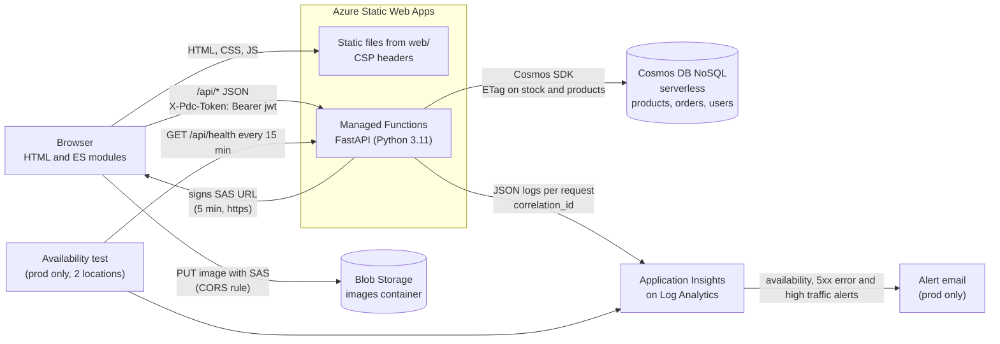
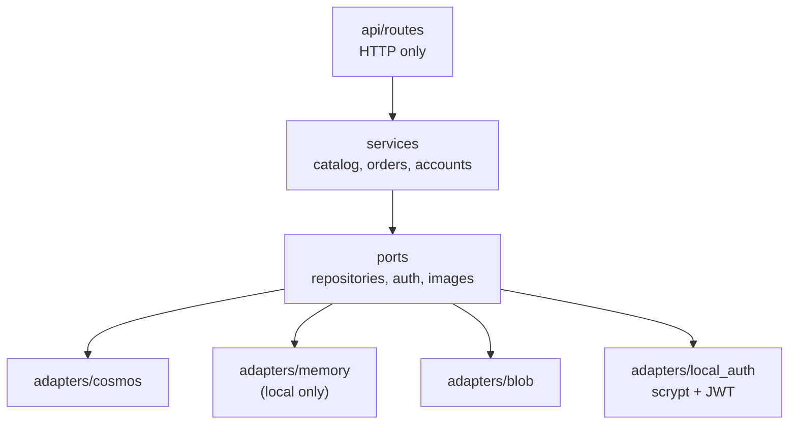
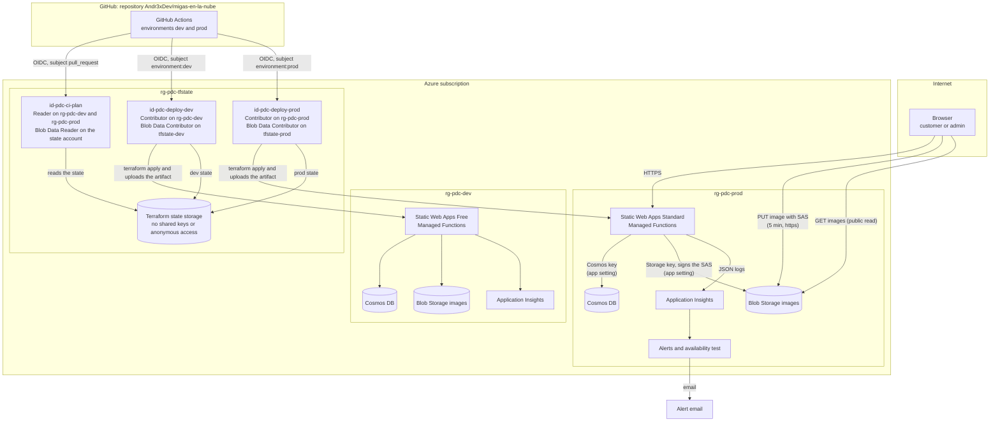
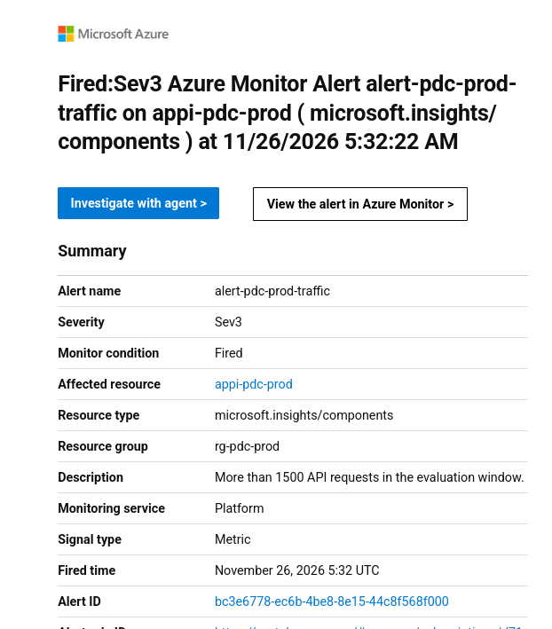
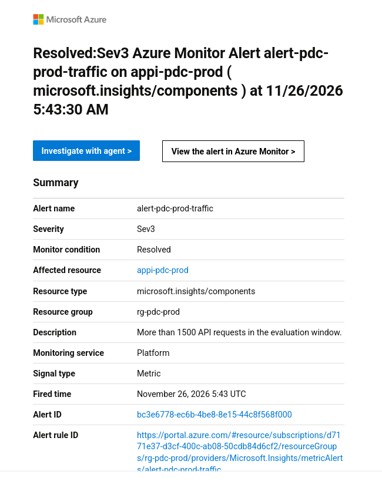
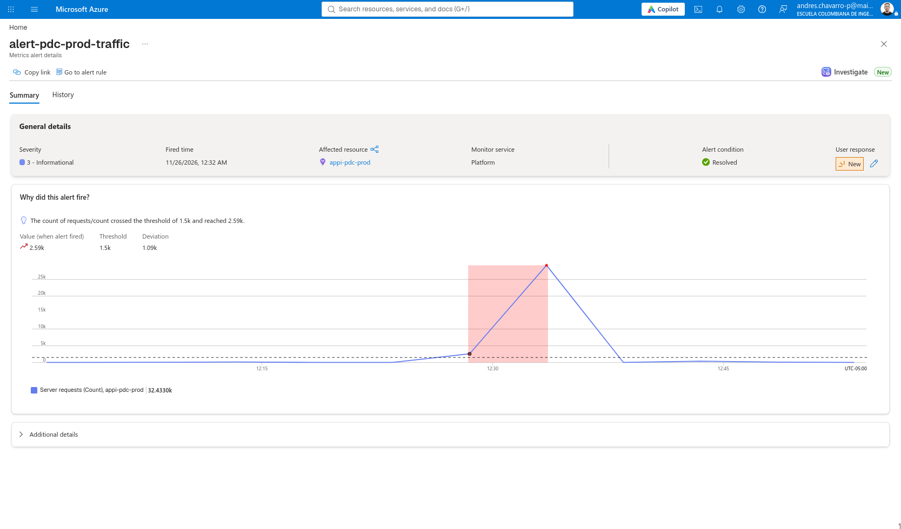
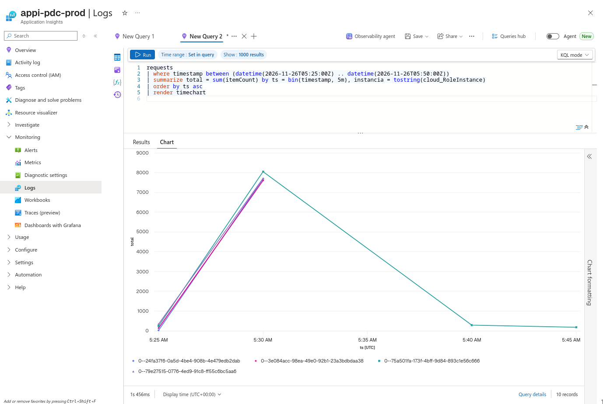
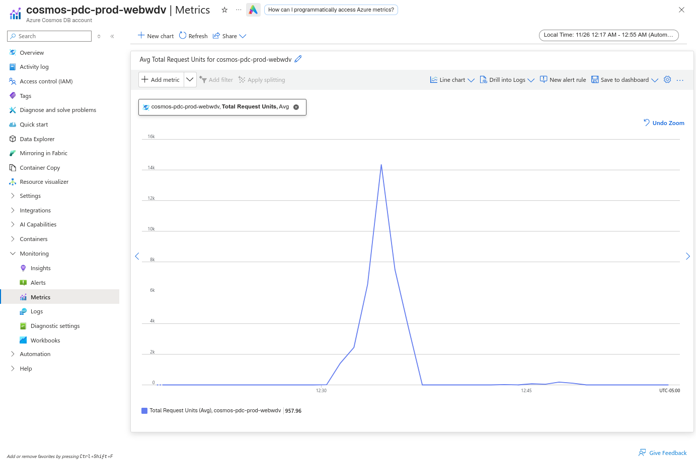

# HLD Migas en la Nube

Nov 25, 2026 · @Andres

## 1. Contexto del negocio y alcance

Migas en la Nube es una panadería de barrio con una sede que hoy recibe pedidos por teléfono y WhatsApp. La solución lleva esa operación a la nube con una tienda web para pedir y recoger en tienda, sobre Azure, serverless y con un costo de producción menor a USD 150 al mes.

**Problema.** Los pedidos se pierden o se anotan mal, el cliente no sabe si un producto está disponible ni cuándo estará listo, y los fines de semana la demanda se triplica.

**Objetivo.** Que cualquier cliente pueda ver el catálogo y dejar un pedido con hora de recogida, con o sin cuenta, y que el administrador gestione productos, imágenes y pedidos desde un panel.

**Actores.**

| Actor | Qué hace |
| --- | --- |
| Cliente invitado | Consulta el catálogo y hace un pedido con nombre, teléfono y hora de recogida |
| Cliente registrado | Lo mismo, más historial de pedidos, favoritos, volver a pedir y sus productos más pedidos |
| Administrador | Crea y edita productos, variantes e imágenes, ve los pedidos próximos y los históricos y cambia su estado. No puede hacer pedidos |



**Alcance del MVP (implementado; desplegado en dev, prod se publica con el primer release (vN), pendiente de verificar).**

- Catálogo con variantes, precio, imagen y estimado de preparación cuando no hay stock.
- Carrito en el navegador, con selección de las líneas que se quieren pedir, y pedido como invitado.
- Registro e inicio de sesión con correo y contraseña, historial y favoritos.
- Panel de administración de productos (con diálogo de edición y subida de imágenes) y de pedidos (próximos, históricos y filtro por día).
- Dos ambientes, dev y prod, creados con Terraform y desplegados solo desde GitHub Actions.

**Fuera del alcance (documentado como evolución).** Pagos en línea, notificaciones por correo a los clientes, recuperación de contraseña y verificación de correo, login con Microsoft por Entra External ID, recomendador real, Key Vault con identidad administrada, Front Door o WAF, private endpoints y despliegue multi región.

## 2. Requisitos y supuestos

El sistema cubre 8 requisitos funcionales y los 6 no funcionales que pide el caso. Cada requisito no funcional tiene una forma concreta de cumplirse y de comprobarse.

### Requisitos funcionales

| ID | Requisito | Quién |
| --- | --- | --- |
| RF1 | Ver el catálogo con fotos, precios, variantes y disponibilidad | Todos |
| RF2 | Si un producto no tiene stock, mostrar cuánto tarda en prepararse | Todos |
| RF3 | Armar un carrito, elegir qué líneas se piden y hacer un pedido con hora de recogida. El administrador no puede pedir: el API responde 403 y la interfaz oculta el carrito | Invitado y registrado |
| RF4 | Comprar sin cuenta dando nombre y teléfono | Cliente invitado |
| RF5 | Registrarse e iniciar sesión con correo y contraseña | Cliente |
| RF6 | Ver historial, marcar favoritos, volver a pedir y ver sus productos más pedidos | Cliente registrado |
| RF7 | Crear y editar productos, variantes, precios, stock y tiempo de preparación, y subir la imagen del producto. Si dos administradores editan el mismo producto, el segundo recibe un conflicto (ETag) en lugar de pisar el cambio | Administrador |
| RF8 | Ver los pedidos próximos (recibidos, en preparación y listos, de cualquier fecha, el más cercano primero) y los históricos (entregados y cancelados, de cualquier fecha, el más reciente primero, hasta 100), filtrar por un día y cambiar el estado del pedido | Administrador |

### Requisitos no funcionales

| Requisito | Meta | Cómo se cumple | Cómo se comprueba |
| --- | --- | --- | --- |
| Presupuesto | Máximo USD 150 al mes en producción | Servicios serverless que se pagan por uso | Calculadora de Azure ([costs/azure.xlsx](costs/azure.xlsx)) y presupuesto con alertas al 50, 80 y 100 % |
| Disponibilidad | 99,5 % en horario comercial | Servicios con SLA publicado de 99,9 % o más y escalado automático | Prueba de disponibilidad en Application Insights, cada 15 minutos desde 2 ubicaciones |
| Seguridad | HTTPS, secretos fuera del código, mínimo privilegio | HTTPS por defecto, secretos generados por Terraform, una identidad por ambiente | Checkov y CodeQL en el pipeline, escaneo de secretos activado en el repositorio |
| Respaldo | RPO 24 h y RTO 4 h | Respaldo continuo de 7 días en Cosmos DB y toda la infraestructura en Terraform | Procedimiento de restauración documentado (sección 5). Simulacro de restauración pendiente |
| Escalabilidad | Soportar 3 veces la carga en temporada alta | Functions y Cosmos DB serverless escalan solos | Cálculo de capacidad en la sección 3 |
| Observabilidad | Logs centralizados, métricas y al menos una alerta | Application Insights sobre Log Analytics, alertas de errores, de disponibilidad y de tráfico alto | Alerta de tráfico verificada: se disparó y se resolvió con correos (sección 6). Las de disponibilidad y 5xx no se han disparado (no hubo una falla real) |

### Supuestos

| Supuesto | Entre semana (22 días al mes) | Fin de semana, pico 3x (8 días al mes) |
| --- | --- | --- |
| Sedes | 1 | 1 |
| Visitas al día | 500 | 1.500 |
| Pedidos al día | 40 | 120 |
| Pedidos de clientes registrados | 20 % | 20 % |
| Productos por pedido | 3 | 3 |
| Productos en catálogo | 60, con 1 a 4 variantes cada uno | 60 |
| Tamaño de cada imagen | Unos 100 KB después de comprimir (supuesto) | Unos 100 KB |
| Horario comercial | 6:00 a 20:00 | 6:00 a 20:00 |
| Hora de más movimiento | Sin pico marcado | Sábado de 9:00 a 11:00, unas 300 visitas por hora |

Al mes son unas 23.000 visitas y 1.840 pedidos (22 × 500 + 8 × 1.500 y 22 × 40 + 8 × 120). Estos mismos números se usan en la estimación de costos y en el cálculo de escalado. La hora de recogida se valida en la zona horaria de la tienda (UTC-5) entre las 6:00 y las 20:00.

## 3. Arquitectura propuesta

La solución es serverless sobre Azure: un sitio estático en Static Web Apps, un API en Python dentro de Azure Functions y datos en Cosmos DB. No hay servidores que administrar y todo escala solo con la demanda.



### Servicios por capa

| Capa | Servicio | Para qué |
| --- | --- | --- |
| Presentación | Azure Static Web Apps | Sirve el sitio (HTML, CSS y JS) con HTTPS y certificado administrado, y las cabeceras de seguridad |
| Lógica | Azure Functions administradas por Static Web Apps, Python 3.11 con FastAPI | API en la ruta /api, reglas de negocio y autenticación con JWT |
| Datos | Azure Cosmos DB for NoSQL en modo serverless | Productos, pedidos y usuarios |
| Archivos | Azure Blob Storage | Imágenes de los productos. El navegador las sube directo con una URL SAS que firma el API |
| Observabilidad | Application Insights y Log Analytics | Logs, métricas, alertas y prueba de disponibilidad |
| Entrega | GitHub Actions y Terraform | Pruebas, análisis y despliegue automático a dev y prod |

**Modelo de datos.** Cosmos DB guarda documentos JSON, lo que permite que cada producto tenga variantes distintas (tamaño, sabor, relleno) sin cambiar un esquema. La base se llama `migas` y tiene un contenedor por colección.

| Contenedor | Clave de partición | Por qué |
| --- | --- | --- |
| products | /category | El catálogo se consulta por categoría. Leer un producto por id es una consulta entre particiones, aceptable con 60 productos |
| orders | /pickupDate | Los pedidos de un día están en una sola partición. Las vistas Próximos e Históricos del administrador consultan varias particiones, con volumen pequeño |
| users | /email | Llave única sobre el correo y login como lectura directa |

**Organización del código.** El API sigue el patrón de puertos y adaptadores. Las rutas de FastAPI llaman a servicios con las reglas de negocio, y los servicios hablan con repositorios que tienen versión para Cosmos DB, para Blob Storage y una en memoria que solo se permite con `PDC_ENVIRONMENT=local`, para las pruebas y el desarrollo.



**Concurrencia.** El stock y la edición de productos usan bloqueo optimista con el ETag de Cosmos DB: ante un conflicto el stock hace hasta 5 intentos y la edición de un producto devuelve 409. Es una limitación aceptada que dos clientes puedan tomar la última unidad a la vez: el segundo pedido se acepta como hecho por encargo.

**Escalado para el pico del sábado (3x).** Con los supuestos de la sección 2, el pico es el sábado de 9:00 a 11:00, con unas 300 visitas por hora, es decir, menos de 1 visita por segundo (unas 0,08). Con un supuesto de unas 6 llamadas al API por visita son unas 0,5 llamadas por segundo, y aun con un margen de ráfaga de 5 por segundo. Functions administradas agrega instancias solo cuando la carga sube y Cosmos DB serverless admite miles de unidades de solicitud por segundo, así que el pico queda muy por debajo del límite. El costo de esto es el arranque en frío, que puede sumar algunos segundos a la primera petición después de un rato sin uso (valor estimado, no medido).

**Región.** Central US: es el valor por defecto del bootstrap (`infra/bootstrap/variables.tf`) y los dos ambientes heredan la ubicación de su grupo de recursos. La elección parte de las regiones permitidas por la suscripción de estudiante. West US 3 queda como plan B y no está configurada en el código.

## 4. Seguridad e identidad

Toda la comunicación va por HTTPS, ningún secreto vive en el código y cada identidad tiene solo los permisos que necesita.



**Usuarios de la aplicación.** El API maneja su propio registro e inicio de sesión con correo y contraseña (ADR 3).

- Las contraseñas se guardan con hash scrypt y sal, nunca en texto plano.
- Al iniciar sesión el API entrega un token JWT firmado (HS256) que dura 1 hora y lleva el rol del usuario (cliente o administrador). Un cambio de rol se aplica cuando vence el token.
- El navegador envía el token en la cabecera `X-Pdc-Token: Bearer <jwt>`, no en `Authorization`, porque las Functions administradas de Static Web Apps sobrescriben `Authorization`.
- Las rutas de cliente piden un token válido y las de administración piden además el rol de administrador.
- Nadie puede registrarse como administrador: el registro ignora el campo de rol. El administrador lo crea el despliegue: en cada deploy el script `seed_admin` toma `ADMIN_EMAIL` (variable del environment) y `ADMIN_INITIAL_PASSWORD` (secreto del environment) y deja a ese usuario con rol de administrador y esa contraseña, de modo que el secreto de GitHub es la fuente de verdad.
- La llave que firma los tokens la genera Terraform (`random_password`) y llega a la aplicación como configuración (`PDC_JWT_KEY`), nunca pasa por el repositorio.

**Identidades del pipeline.** GitHub Actions entra a Azure con OIDC, sin contraseñas guardadas. Hay una identidad por uso, creadas por el bootstrap en el grupo `rg-pdc-tfstate`:

| Identidad | Cuándo se usa (subject OIDC) | Permisos |
| --- | --- | --- |
| id-pdc-ci-plan | En cada pull request (`pull_request`) | Reader sobre `rg-pdc-dev` y `rg-pdc-prod` y lectura del estado de Terraform |
| id-pdc-deploy-dev | Al desplegar a dev (`environment:dev`) | Contributor solo sobre `rg-pdc-dev` y escritura del estado `tfstate-dev` |
| id-pdc-deploy-prod | Al desplegar a prod, con aprobación (`environment:prod`) | Contributor solo sobre `rg-pdc-prod` y escritura del estado `tfstate-prod` |

Así, un error en dev no puede tocar prod, y un pull request no puede cambiar nada en Azure.

**Secretos.**

| Secreto | Dónde vive | Quién lo crea |
| --- | --- | --- |
| Llaves de Cosmos DB y Storage | Configuración de la app en Azure | Terraform |
| Llave de firma de los JWT | Configuración de la app en Azure | Terraform |
| Token de despliegue de Static Web Apps | Salida de Terraform, leída y enmascarada en el mismo paso del pipeline (`::add-mask::`) | Terraform |
| Contraseña inicial del administrador | Secreto `ADMIN_INITIAL_PASSWORD` de cada environment de GitHub | El equipo |

Los IDs de tenant, suscripción e identidades son variables de GitHub, no secretos. Static Web Apps no tiene identidad administrada, por eso el API usa llaves de Cosmos DB y Storage en lugar de identidades.

**Escaneo y análisis.** El pipeline corre Checkov sobre Terraform y CodeQL sobre Python. En el repositorio están activados el escaneo de secretos y su protección contra push (verificado con la API de GitHub el 25 de noviembre de 2026). La demostración de que un push con un secreto es bloqueado queda como verificación pendiente.

**Protecciones adicionales.**

- Cabeceras de seguridad en el sitio: política de contenido (CSP) que solo permite scripts y estilos propios, `nosniff` y `frame-ancestors 'none'`. La interfaz pinta con `textContent`, nunca con `innerHTML`.
- Validación de todas las entradas con Pydantic y límites: hasta 20 líneas por pedido, 50 unidades por línea, 100 caracteres en el nombre, 10 dígitos en el teléfono, contraseña de 8 a 1.024 caracteres, precio, stock y tiempo de preparación con tope.
- La hora de recogida no puede ser anterior a ahora, debe caer en el horario de la tienda y no puede ser más de 30 días adelante.
- Mensajes de error genéricos en el login (un solo 401 con un retardo de 0,5 s tras un fallo) y estado de Terraform sin llaves compartidas ni acceso anónimo.
- URL SAS para subir imágenes: un solo blob, solo crear y escribir, 5 minutos, solo https, con regla CORS limitada al host del sitio. El límite de 2 MB se comprueba solo en el navegador.

**Riesgos aceptados.** Cosmos DB usa llaves en lugar de identidad administrada, y el contenedor de imágenes es de lectura pública porque las fotos del catálogo son públicas. Ambos quedan como excepciones justificadas en Checkov y se resuelven en la evolución descrita en la sección 9.

## 5. Disponibilidad, respaldo y recuperación

La solución cumple el 99,5 % en horario comercial, el RPO de 24 horas y el RTO de 4 horas usando las capacidades propias de los servicios, sin infraestructura extra.

**Disponibilidad.**

| Servicio | SLA del proveedor |
| --- | --- |
| Static Web Apps Standard (prod) | 99,95 % |
| Cosmos DB en una región | 99,99 % |
| Blob Storage LRS | 99,9 % en lectura |

La combinación queda por encima del 99,5 % pedido: aun con 99,9 % en los tres servicios el producto es de 99,7 %. Los valores son los publicados por Microsoft y no se verifican en el repositorio, por lo que se deben confirmar en la página de SLA antes de entregar (pendiente). Producción usa el plan Standard de Static Web Apps (`infra/envs/prod/main.tf`) porque el plan Free no tiene SLA. Dev usa Free para ahorrar. El escalado automático evita caídas por carga en el pico de fin de semana, y la prueba de disponibilidad avisa si el sitio deja de responder.

**Respaldo.** La cuenta de Cosmos DB se crea con respaldo continuo de 7 días (`type = "Continuous"`, `tier = "Continuous7Days"` en `infra/modules/cosmos/main.tf`), que permite restaurar los datos a cualquier momento de esa semana. Eso deja el RPO en minutos, muy por debajo de las 24 horas pedidas, siempre que el problema se detecte dentro de los 7 días. No hay respaldo periódico configurado. Las imágenes están en una cuenta de Blob Storage LRS con versionado y retención de borrado de 7 días (`infra/modules/storage/main.tf`): se puede recuperar una imagen reemplazada o borrada en ese plazo, pero no hay copia en otra región. Las imágenes subidas por el administrador no están en el repositorio.

**Recuperación.** Toda la infraestructura está en Terraform, así que se puede recrear con un despliegue. El procedimiento documentado ante una pérdida de datos es:

1. Restaurar la cuenta de Cosmos DB a un punto en el tiempo anterior al problema desde el portal o con la CLI de Azure. Azure crea una cuenta nueva con los datos restaurados. La restauración la hace el propietario de la suscripción: se debe verificar si la identidad de despliegue tiene el permiso necesario.
2. Revisar los datos de la cuenta restaurada.
3. Apuntar la aplicación a la cuenta restaurada y dejar a Terraform como dueño de ella. El detalle exacto de cómo Terraform adopta la cuenta restaurada se define y se ensaya en el simulacro.
4. Volver a desplegar la aplicación y correr el smoke test.

Tiempo estimado del procedimiento: entre 1 y 2 horas, dentro del RTO de 4 horas. Es una estimación, no una medición. El simulacro de restauración está pendiente y es el que valida el tiempo y los pasos 1 y 3.

**Lo que no cubre.** Una caída completa de la región Central US. Para eso haría falta una segunda región, que se deja como evolución por costo (sección 9).

## 6. Observabilidad y operación

Todos los logs y métricas llegan a un solo lugar, Application Insights sobre un workspace de Log Analytics, y en producción hay tres alertas de Application Insights y un presupuesto con alertas, todos por correo.

**Qué se recoge.**

- Peticiones al API con su ruta, tiempo de respuesta y código de estado.
- Excepciones del API.
- Una línea de log JSON por petición, con `method`, `path`, `status`, `duration_ms` y `correlation_id`. Si la petición trae un `x-correlation-id` válido (hasta 64 caracteres de `A-Z a-z 0-9 . _ -`) se reutiliza, y si no el API crea uno. El identificador está solo en los logs y no se devuelve en la respuesta; sirve para seguir una petición de punta a punta con una consulta como `traces | where message has "<id>"`.

**Alertas.**

| Alerta | Se dispara cuando | Acción |
| --- | --- | --- |
| Errores del API (prod) | Más de 5 peticiones fallidas con 5xx en 15 minutos (se evalúa cada 5 minutos) | Correo mediante un grupo de acción |
| Disponibilidad (prod) | La prueba `GET /api/health`, que corre cada 15 minutos desde 2 ubicaciones (`us-tx-sn1-azr` y `us-il-ch1-azr`) con reintento, falla desde las 2 en una ventana de 30 minutos (se evalúa cada 5 minutos), de modo que las ejecuciones de las dos ubicaciones caen dentro de la ventana | Correo mediante el mismo grupo de acción. Se mantiene `failed_location_count = 2` para no alertar por una sola ubicación inestable. No se ha disparado porque no hubo una falla real; su disparo no está verificado |
| Tráfico alto (prod) | Más de 1.500 peticiones al API (`requests/count`) en 5 minutos (se evalúa cada minuto, severidad 3, se resuelve sola al bajar el tráfico) | Correo mediante el mismo grupo de acción. Es un aviso de tráfico por encima del diseño, no una falla |
| Presupuesto (suscripción) | El gasto real llega al 50, 80 y 100 % del monto mensual del presupuesto | Correo a `budget_email` |

El correo de las alertas de producción es la variable `ALERT_EMAIL` del environment `prod`. Dev no tiene alertas ni prueba de disponibilidad. El monto del presupuesto lo fija `budget_amount` del bootstrap (el ejemplo del repositorio usa 20, menos que el tope de USD 150), así que los umbrales son porcentajes de ese monto y no de 150. Falta comprobar en el portal (pendiente) que el presupuesto exista, porque en algunas suscripciones de estudiante puede ser rechazado. La alerta de errores 5xx no se ha disparado con tráfico de prueba.

**Umbral de tráfico alto.** El umbral de 1.500 peticiones en 5 minutos es unas 5 veces el pico de un sábado a 3x (450 llamadas al API en 5 minutos). Solo cuentan las llamadas al API, porque los archivos estáticos los sirve Static Web Apps y no pasan por Functions. Los escenarios de [load/README.md](../load/README.md) quedan así: `realistic` (150) y `peak3x` (450) no la disparan; `stress` (unas 32.000 llamadas en 5 minutos) sí. Umbral, ventana y frecuencia son las variables `traffic_spike_threshold`, `traffic_spike_window` y `traffic_spike_frequency` del módulo `alerts`.

**Demostración de alertas.**

1. Fuera de horario, correr `stress` en prod desde el workflow `load.yml` (una sola vez).
2. En el portal, en Monitor > Alertas, la alerta de tráfico alto pasa a `Fired` pocos minutos después de empezar.
3. Llega el correo al buzón de `ALERT_EMAIL`.
4. Al terminar la prueba y bajar el tráfico, la alerta se resuelve sola y llega el aviso de resuelta.

**Resultado (verificado el 26 de noviembre de 2026).** `alert-pdc-prod-traffic` (severidad 3, `appi-pdc-prod`, `rg-pdc-prod`, "More than 1500 API requests in the evaluation window") se disparó durante la corrida de `stress` y se resolvió sola; el correo `Resolved` llegó a las 05:43:30 UTC, unos 8 minutos después de terminar `stress` (hacia las 05:35). La corrida `peak3x` (05:40) quedó por debajo del umbral. Los correos reales prueban el canal de correo. Las alertas de errores 5xx y de disponibilidad no se dispararon porque no hubo una falla real; no se simuló ninguna, así que su disparo no está verificado.







5. Prueba del canal de correo sin generar tráfico: en el portal, grupo de acción `ag-<prefijo>-prod` > `Probar grupo de acción` (Test action group), tipo de muestra `Metric alert` (Alerta de métricas), y comprobar que llega el correo. El comando `az monitor action-group test-notifications create` existe, pero sus argumentos no se verificaron, por eso se documenta el botón del portal.

`stress` también puede disparar las alertas de 5xx, de disponibilidad y de tráfico alto; es esperado.

**Métricas que se revisan.** Tiempo de respuesta y tasa de peticiones fallidas del API, disponibilidad y consumo de Cosmos DB en unidades de solicitud, todas en el portal de Azure. Los pedidos por hora se obtienen contando en los logs las peticiones `POST /api/orders` con estado 201. No hay un panel (dashboard) definido en Terraform.

**Control de costo de la telemetría.** Muestreo en Application Insights de 5 elementos por segundo, sin muestrear las peticiones ni las excepciones (`api/host.json`), y retención de 30 días en Application Insights y en Log Analytics (`infra/modules/observability/variables.tf`), para que los logs no crezcan sin control.

**Operación del día a día.** El administrador gestiona productos y pedidos desde el panel. Los cambios de código o infraestructura solo entran por pull request y pipeline, nunca a mano en el portal.

### Prueba de carga

Para comprobar el requisito de escalabilidad (3 veces la carga del pico) se usa k6 desde el workflow manual `load.yml` (detalle en [load/README.md](../load/README.md)). Parte de los supuestos de la sección 2: unas 300 visitas por hora en el pico del sábado y 10 peticiones por visita (4 estáticas y 6 llamadas al API, como en la sección 3). Las tasas son tan bajas que `stress` es el escenario que demuestra el escalado.

| Escenario | Carga | Ambiente |
| --- | --- | --- |
| `realistic` | 5 visitas por minuto (el pico) durante 5 minutos: 25 visitas, 250 peticiones, 150 al API | dev y prod, solo lectura |
| `peak3x` | 15 visitas por minuto (3 veces el pico) durante 5 minutos: 75 visitas, 750 peticiones, 450 al API | dev y prod, solo lectura |
| `stress` | Rampa de 5 minutos hasta 40 visitas por segundo (unas 480 veces el pico): unas 5.340 visitas, unas 53.400 peticiones, unas 32.000 al API y hasta 240 llamadas al API por segundo | dev y prod, solo lectura |
| `orders` | 6 pedidos de invitado por minuto durante 3 minutos | solo dev, escribe datos |

Umbrales: tasa de peticiones fallidas menor a 1 %, p95 del tiempo de respuesta menor a 1000 ms y ninguna iteración descartada (`dropped_iterations` igual a 0), sin contar el calentamiento inicial de 30 s que absorbe el arranque en frío.

**Riesgo de `stress` en producción.** Es la validación del escalado y se permite en producción, pero puede producir errores reales (Cosmos DB serverless puede responder 429 ante una ráfaga), añadir latencia a clientes reales y disparar las alertas de 5xx, de disponibilidad y de tráfico alto (correos). Se corre fuera de horario y una sola vez. El costo por corrida es despreciable; el riesgo es de disponibilidad, no de dinero.

**Resultados.** Corridas del workflow `load` del 26 de noviembre de 2026 (UTC). Las peticiones y las iteraciones incluyen el calentamiento y el `setup`.

| Ambiente | Escenario | Corrida | p95 (ms) | Promedio / p90 / máximo (ms) | Peticiones fallidas | Peticiones | Iteraciones | Descartadas | VUs máximos | Resultado |
| --- | --- | --- | --- | --- | --- | --- | --- | --- | --- | --- |
| dev | `realistic` | [45757984915](https://github.com/Andr3xDev/migas-en-la-nube/actions/runs/45757984915) | 90 | 61 / 88 / 1.744 | 0 % | 271 | 31 | 0 | 3 | Pasa |
| dev | `orders` | [45758851277](https://github.com/Andr3xDev/migas-en-la-nube/actions/runs/45758851277) | 343 | 185 / 263 / 400 | 0 % | 30 | 24 | 0 | 3 | Pasa |
| prod | `realistic` | [45759342723](https://github.com/Andr3xDev/migas-en-la-nube/actions/runs/45759342723) | 74 | 40 / 62 / 132 | 0 % | 271 | 31 | 0 | 3 | Pasa |
| prod | `peak3x` | [45763172806](https://github.com/Andr3xDev/migas-en-la-nube/actions/runs/45763172806) | 91 | 55 / 87 / 671 | 0 % (0 de 771) | 771 | 81 | 0 | 6 | Pasa |
| prod | `stress` | [45761827371](https://github.com/Andr3xDev/migas-en-la-nube/actions/runs/45761827371) | 111 | 54 / 92 / 4.835 | 0 % | 52.991 (unas 160 por segundo en promedio) | 5.303 | 41 | 62 | Falla solo por `dropped_iterations` |

| Resultado de `stress` en prod | Valor |
| --- | --- |
| p95 del tiempo de respuesta | 111 ms (umbral: 1000 ms) |
| Tasa de peticiones fallidas | 0 % |
| Carga absorbida | Unas 53.000 peticiones con 0 % de errores |
| Iteraciones descartadas | 41 (0,77 %) |
| Instancias máximas observadas | Ver captura `escalado-instancias.png` (más abajo) |

**Interpretación de `stress`.** El sistema absorbió unas 53.000 peticiones con 0 % de errores y un p95 de 111 ms. Las 41 iteraciones descartadas (0,77 %) se deben a que k6 no asignó VUs con la rapidez necesaria en los saltos de la rampa (`preAllocatedVUs` en 20; solo se usaron 62 de los 200 VUs máximos): es un límite del generador de carga, no un error del servidor. El máximo de 4,8 s es una cola aislada, probablemente un arranque en frío mientras escalaba. Por eso el umbral `dropped_iterations` marcó la corrida como fallida aunque la latencia y los errores cumplieron. Para próximas corridas `preAllocatedVUs` sube a 100 en `load/load.js`. `realistic` y `peak3x` (3 veces el pico) pasan todos los umbrales en prod.

**Evidencia de escalado y desescalado.** k6 prueba que el sistema absorbe la carga (p95, errores, iteraciones descartadas), pero no cuántas instancias hubo. Durante y después de la corrida de `stress` en prod, en el portal (Application Insights, Logs) se ejecuta:

```kusto
requests
| where timestamp > ago(1h)
| summarize instancias = dcount(cloud_RoleInstance), peticiones = count() by bin(timestamp, 1m)
| render timechart
```

Se espera que `instancias` suba durante `stress` y baje unos minutos después de que termine (desescalado). No está verificado que las Functions administradas de Static Web Apps reporten un `cloud_RoleInstance` por instancia; si el gráfico muestra siempre 1, la evidencia es la latencia estable de k6 y las métricas de Cosmos DB. Cosmos DB serverless no tiene instancias: su evidencia es la métrica `Total Request Units` (portal, cuenta de Cosmos DB, Metrics) durante la corrida y si aparecieron respuestas 429. La alerta de tráfico alto pasando a `Fired` y luego a `Resolved` también muestra la subida y la bajada de la carga.





## 7. Diseño de despliegue

Todo llega a Azure por GitHub Actions: nada se despliega a mano. Cada etapa del pipeline bloquea a la siguiente si falla, y producción necesita aprobación. Las etapas, los disparadores, los secretos y el rollback paso a paso están en [despliegue.md](despliegue.md).

- **Ambientes.** `dev` (rama `dev`, Static Web Apps Free, sin aprobación ni alertas) y `prod` (rama `main`, Standard, revisor requerido y alertas). Cada uno tiene su propio grupo de recursos, estado de Terraform, cuenta de Cosmos DB y de Storage e identidad.
- **Promoción.** Todo cambio entra por pull request a `dev` y luego de `dev` a `main`. El workflow `ci` corre en el pull request (lint, seguridad, pruebas con cobertura mínima de 70 %, build y plan de Terraform). Al hacer merge, `deploy` aplica Terraform, carga los seeds, sube la aplicación y corre el smoke test. En `main` espera la aprobación del environment `prod` y publica el release `vN`. Los checks requeridos del ruleset de GitHub deben ser los jobs de `ci.yml`; su estado de aplicación está pendiente de verificar por el equipo.
- **OIDC.** El acceso a Azure usa las identidades de la sección 4, sin contraseñas guardadas. El único secreto en GitHub es la contraseña inicial del administrador, y los tokens leídos de las salidas de Terraform se enmascaran en los logs.
- **Rollback.** De la aplicación: workflow manual `rollback` con el tag de una versión anterior, que vuelve a publicar su artefacto sin tocar la infraestructura. De la infraestructura: revertir el commit. De los datos: restauración de Cosmos DB (sección 5).
- **Bootstrap.** Lo que el pipeline necesita antes de su primera ejecución (grupos de recursos, estado, identidades OIDC y presupuesto) vive en un Terraform aparte que se aplica una sola vez. El orden de limpieza final está en [infra/bootstrap/README.md](../infra/bootstrap/README.md).

## 8. Costos y FinOps

Producción cuesta unos USD 15 al mes con el tráfico de la sección 2, muy por debajo del tope de USD 150. Los valores salen de la exportación de la calculadora de Azure (Central US, USD). Las entradas de Blob (1.000 GB de lectura y de escritura) y de Cosmos DB (copia de seguridad periódica) son conservadoras, más altas que el modelo de uso de este documento, así que el costo real debería ser menor.

**Estimación mensual en producción.**

| Servicio | Supuesto de uso | USD al mes | USD al año |
| --- | --- | --- | --- |
| Static Web Apps Standard (prod) | 1 app | 9,00 | 108 |
| Cosmos DB for NoSQL serverless | 1 millón de unidades de solicitud, 1 GB y copia de seguridad periódica | 0,67 | 8 |
| Storage Accounts, Block Blob GPv2 LRS Hot | 1 GB, con entradas conservadoras de operaciones, lectura y escritura de datos | 1,77 | 21 |
| Azure Monitor | Application Insights con 0,02 GB al día, 2 pruebas web estándar cada 15 minutos durante 730 h (5.840 ejecuciones), 3 series de alertas de métricas y logs | 3,59 | 43 |
| Salida de datos (egress) | Unos 18 GB al mes de imágenes, dentro del ancho de banda incluido en Static Web Apps (100 GB gratuitos) | 0,00 | 0 |
| Grupo de acción | Correo, sin costo | 0,00 | 0 |
| Soporte | Sin plan de soporte | 0,00 | 0 |
| **Total** | | **15,0** | **180** |

La exportación no desglosa Azure Monitor. Por diferencia, las pruebas web cuestan unos USD 3,3 al mes (3,59 menos unos 0,30 de alertas y logs menores); es una estimación.

Dev (Static Web Apps Free, uso serverless mínimo) y el estado de Terraform (una cuenta de Storage de 1 GB) quedan fuera de la estimación por su costo despreciable.

**Escenarios.**

| Escenario | Qué incluye | USD al mes (aprox.) |
| --- | --- | --- |
| MVP | Prod con tráfico de prueba y dev en Free | Unos 15 |
| Producción | Los supuestos de la sección 2 (unas 23.000 visitas y 1.840 pedidos al mes) | Unos 15 |

**Optimizaciones FinOps.**

| Optimización | Alternativa sin optimizar | Ahorro estimado al mes |
| --- | --- | --- |
| Cosmos DB serverless | Capacidad aprovisionada mínima de 400 unidades por segundo, unos USD 23 al mes | Unos USD 22 |
| Dev en plan Free de Static Web Apps, que puede destruirse a mano con `destroy.yml` cuando no se usa | Dev en Standard todo el mes | USD 9 |
| Prueba de disponibilidad en 1 ubicación o cada 30 minutos | Prueba en 2 ubicaciones cada 15 minutos | Unos USD 1,6 al mes (cerca del 50 % de las pruebas web) |
| Imágenes comprimidas y caché del navegador | Imágenes sin comprimir ni caché, con más salida de datos | Mantiene la salida dentro de los 100 GB gratuitos |
| Muestreo y retención de 30 días en la telemetría | Telemetría completa que puede pasar los 5 GB gratuitos | Depende del tráfico, evita sobrecostos |

Además hay un presupuesto mensual de la suscripción con alertas al 50, 80 y 100 %.

Exportación de la calculadora de Azure (Central US, USD): [docs/costs/azure.xlsx](costs/azure.xlsx).

## 9. Riesgos y mitigaciones

Los riesgos principales vienen de lo que se simplificó para el MVP, y cada uno tiene una mitigación actual y una evolución propuesta.

| Riesgo | Impacto | Mitigación actual | Evolución |
| --- | --- | --- | --- |
| Autenticación propia sin verificación de correo ni recuperación de contraseña. El registro revela si un correo ya existe (409) | Medio | Hash scrypt, tokens de 1 hora, errores genéricos en el login y retardo ante intentos fallidos | Migrar a Entra External ID y agregar login con Microsoft |
| Token JWT guardado en el navegador (`localStorage`) | Medio | Política de contenido que limita scripts, interfaz sin `innerHTML` y tokens de vida corta | Cookies seguras o el flujo del proveedor de identidad |
| Cosmos DB con llaves en lugar de identidad administrada | Medio | Llaves generadas por Terraform, nunca en el repositorio, solo en la configuración de la app | Function App propia con identidad administrada y Key Vault |
| El estado de Terraform contiene secretos y la identidad `id-pdc-ci-plan` puede leerlo desde cualquier pull request del mismo repositorio | Medio | Solo los colaboradores abren esos pull requests y los de forks no reciben token OIDC | Quitar los secretos del estado con Key Vault |
| Contenedor de imágenes público | Bajo | Solo contiene fotos del catálogo, que son públicas | CDN con acceso privado al almacenamiento |
| Arranque en frío de Functions | Bajo | Afecta solo la primera petición tras un rato sin uso | Plan con instancias siempre listas si el negocio lo pide |
| Dos clientes toman la última unidad al mismo tiempo | Bajo | El segundo pedido se acepta como hecho por encargo | Reserva de stock con transacciones |
| Restauración de datos sin ensayar | Medio | Respaldo continuo de 7 días y procedimiento documentado en la sección 5 | Realizar el simulacro y automatizar la adopción de la cuenta restaurada en Terraform |
| Caída de la región Central US | Alto pero poco probable | Infraestructura en Terraform lista para recrear en otra región | Segunda región con Front Door |
| Sin pagos en línea | Bajo para el negocio actual | Se paga al recoger | Pasarela de pagos |
| Límites de la suscripción de estudiante (regiones y cuotas) | Medio | Región Central US y plan B West US 3 | Suscripción de pago para producción real |
| Gasto inesperado | Bajo | Presupuesto con alertas y servicios que se pagan por uso | Revisión mensual de costos |

## 10. Decisiones de arquitectura

Se tomaron 5 decisiones principales. Cada una responde qué problema había, qué opciones se evaluaron, cuál se eligió y qué se gana y se pierde. Los registros completos, en inglés, están en [docs/adr](adr/README.md).

### ADR 1. Cómputo serverless con Static Web Apps y Functions administradas

**Contexto.** La panadería tiene poco tráfico y a ráfagas, un solo desarrollador y una suscripción de estudiante con presupuesto. El sistema debe costar poco cuando está en reposo, desplegarse solo desde GitHub Actions y ser fácil de destruir.

**Alternativas.**

- App Service con un plan fijo: costo mensual aunque no se use y más cosas que parchear.
- Contenedores (Container Apps o AKS): requieren construir imágenes, un registro y más código de infraestructura del que justifica el proyecto.
- Static Web Apps con una Function App enlazada: funciona, pero agrega un segundo recurso, CORS y otro camino de despliegue. Queda como plan de respaldo.

**Decisión.** Static Web Apps con el API FastAPI como Functions administradas en el mismo host: el navegador llama a `/api/*` en su propio origen. Dev usa el plan Free y prod el Standard.

**Consecuencias.** Sin servidores ni escalado que configurar y costo casi cero en reposo; un host y una acción de despliegue por ambiente. A cambio hay arranque en frío, las Functions administradas exigen el modelo de programación v1 (ADR 5) y Static Web Apps sobrescribe la cabecera `Authorization` (ADR 3). El rollback es volver a publicar un artefacto guardado.

### ADR 2. Cosmos DB for NoSQL en modo serverless

**Contexto.** Los datos son tres colecciones pequeñas (productos, pedidos y usuarios) con accesos simples y tráfico bajo e irregular. El stock no debe quedar negativo cuando dos clientes piden el mismo producto.

**Alternativas.**

- Azure SQL serverless: no se necesita su potencia relacional, exige esquema y migraciones y su autopausa hace lenta la primera consulta.
- Table Storage: consultas limitadas (sin filtros flexibles por día o categoría) y sin llave única sobre el correo.
- Cosmos DB con capacidad aprovisionada: costo fijo sin beneficio con este tráfico.

**Decisión.** Cosmos DB serverless con la base `migas` y un contenedor por colección (`products` por `/category`, `orders` por `/pickupDate`, `users` por `/email`). El stock se protege con bloqueo optimista usando el ETag.

**Consecuencias.** Se paga por solicitud y almacenamiento, sin esquema que migrar y con seeds idempotentes. A cambio, leer un producto por id es una consulta entre particiones, y el bloqueo con ETag no cubre una caída entre pasos de stock ni evita que la última unidad se venda dos veces en una carrera. Ambas ventanas se aceptan.

### ADR 3. Autenticación propia con JWT

**Contexto.** Los clientes se registran con correo y contraseña, también pueden pedir como invitados, y el administrador necesita un rol distinto. El proyecto debe correr en local sin ningún servicio de identidad.

**Alternativas.**

- Microsoft Entra External ID: plataforma de identidad real con MFA y recuperación, pero exige un tenant nuevo, configuración, flujos de redirección y una curva de aprendizaje desproporcionada.
- Autenticación integrada de Static Web Apps: solo proveedores fijos, sin correo y contraseña, y con roles por invitación y no por auto registro.
- Cabecera `Authorization: Bearer`: Static Web Apps la sobrescribe en las Functions administradas, así que se reemplaza por `X-Pdc-Token`.

**Decisión.** El API maneja la autenticación: contraseñas con scrypt y sal, JWT HS256 de 1 hora con el rol, error genérico en el login y token en la cabecera `X-Pdc-Token`.

**Consecuencias.** Sin dependencia externa ni costo, y el código es pequeño y probado. A cambio no hay refresh token, ni recuperación de contraseña, ni login social, un cambio de rol se aplica al vencer el token y una filtración de `PDC_JWT_KEY` invalida toda la confianza (Terraform genera una llave por ambiente).

### ADR 4. Terraform y GitHub Actions con OIDC por ambiente

**Contexto.** Todo en Azure debe ser reproducible y desplegarse solo por GitHub Actions, sin secretos de Azure de larga vida en GitHub. Hay dos ambientes con riesgo distinto: dev (gratis y abierto) y prod (con revisión).

**Alternativas.**

- Service principal con su contraseña en GitHub Secrets: credencial de larga vida que puede filtrarse y debe rotarse.
- Una identidad compartida para los dos ambientes: un workflow de dev podría cambiar prod.
- Bicep o ARM: solo Azure; Terraform da un plan revisable en los pull requests y un escape con el proveedor azapi.
- Despliegues manuales desde el portal o la CLI: no reproducibles ni revisables.

**Decisión.** Terraform con módulos y una raíz por ambiente, estado en una cuenta de Storage endurecida, y un bootstrap local que crea los grupos, el presupuesto y tres identidades federadas por OIDC: `ci-plan` (solo lectura, para pull requests), `deploy-dev` y `deploy-prod`, cada una limitada a su grupo. Un push a `dev` despliega dev y un push a `main` despliega prod con aprobación de revisores requeridos.

**Consecuencias.** No hay secretos de Azure que rotar y un workflow de dev comprometido no toca prod; cada cambio se revisa y su plan es visible antes del merge. A cambio el bootstrap es un paso manual con estado local, y aplicar Terraform en cada despliegue es más lento que subir solo código.

### ADR 5. Python y FastAPI sobre Azure Functions

**Contexto.** El API necesita rutas, validación, inyección de dependencias y buen soporte de pruebas, y debe correr como Functions administradas de Static Web Apps, que admiten pocos runtimes.

**Alternativas.**

- SDK de Functions v2 puro, una función por ruta: la forma `AsgiFunctionApp` falló al desplegarse en Static Web Apps, y los disparadores v2 sueltos obligarían a código por ruta y a perder la validación y la inyección de FastAPI.
- Java (Functions o Spring): build más pesado, arranques en frío más lentos y más código para el mismo API.
- Node.js: viable, pero el equipo conoce mejor Python y las herramientas ya están listas.

**Decisión.** Python 3.11 con FastAPI. Una sola función (`api/http_app`) con ruta comodín `{*route}` entrega cada petición a FastAPI mediante `func.AsgiMiddleware`, con el modelo de programación v1.

**Consecuencias.** Pruebas rápidas con `TestClient` y adaptadores en memoria, y validación y OpenAPI de FastAPI y Pydantic. A cambio, el modelo v1 es más viejo aunque es el que Static Web Apps despliega hoy, y todas las peticiones pasan por el puente ASGI, que suma algo de latencia y de arranque en frío.
